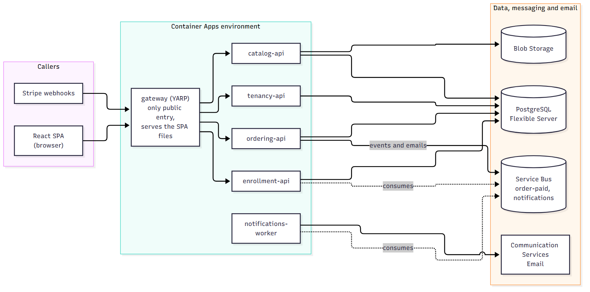

# Athlos

A multi-tenant B2B2C fitness marketplace, built for the master thesis *Design and Implementation of a Multi-Tenant B2B2C Cloud-Native SaaS Platform*.

- **Coaches are tenants.** Each opens a workspace with a branded storefront, sells training programs and is paid through Stripe Connect.
- **Customers are not inside any tenant.** One account buys from any coach.
- **Platform admin.** Suspends workspaces and assigns their plans.

The full design, with the reasoning behind each choice, is in [docs/design.md](docs/design.md). The evidence for the evaluation chapter is in [docs/evaluation/](docs/evaluation/).



## What it demonstrates

- **Tenant isolation in a shared database (pool model), in four layers** (design §3.2):
  1. Every service accepts only requests signed by the gateway.
  2. A per-request tenant context.
  3. EF Core global query filters.
  4. PostgreSQL row-level security with `FORCE`.

  The [isolation suite](tests/Athlos.IsolationTests) calls every endpoint as tenant B against tenant A's resources and expects `404`. It also shows that RLS alone still blocks B with layer 3 turned off.
- **Noisy-neighbor protection** (§4):
  - per-tenant rate limits by plan in the gateway, and quotas in the services;
  - a k6 experiment shows that one coach's flood does not slow the others: [noisy-neighbor.md](docs/evaluation/noisy-neighbor.md).
- **Tenant lifecycle** (§3.4): suspension, and deletion by tenant id in every service, the "right to erasure". Customers can delete their own accounts (§5.2).
- **Cloud-native on a student budget** (§10):
  - Azure Container Apps scaling to zero, with one PostgreSQL server for all environments;
  - everything in Bicep, deployed by GitHub Actions with OIDC;
  - about €3 a month.
- **Per-tenant observability** (§6): OpenTelemetry tagged with the tenant, and an Azure Monitor workbook per coach.

## Repository

| Path | What |
|---|---|
| `src/Gateway` | YARP gateway: routing, token check, tenant resolution, signing, rate limits; serves the SPA |
| `src/Services/*` | tenancy, catalog, ordering and enrollment APIs; one database each, vertical slices under `Features/` |
| `src/Workers/Athlos.Notifications.Worker` | Transactional email from the `notifications` queue |
| `src/BuildingBlocks` | `Athlos.Tenancy` (tenant context, signatures, RLS helpers) and `Athlos.Messaging` (outbox, queues) |
| `src/Tools/Athlos.DbMigrator` | Creates databases and roles, runs migrations, seeds demo coaches |
| `src/web` | React 19 SPA, feature folders, client generated from the OpenAPI documents |
| `src/AppHost`, `src/ServiceDefaults` | Aspire orchestration and shared telemetry setup |
| `infra` | Bicep for the shared and per-environment resources, plus the Entra and Stripe setup scripts |
| `tests` | Integration tests (Testcontainers, PostgreSQL 17), the isolation suite, k6 load tests and the evaluation scripts |

## Run it locally

Needs the .NET 10 SDK, Node 22, Docker Desktop and the Aspire CLI (full list in design §13).

```
aspire run
```

This starts:
- the gateway, the four APIs and the worker;
- PostgreSQL, the Service Bus emulator and Azurite;
- the Vite dev server;
- the Aspire dashboard.

Sign-in uses the Entra External ID tenant. Payments need Stripe test keys in user secrets (`stripe listen` forwards the webhooks).

## Test

```
dotnet test                                                        # backend, needs Docker
cd src/web && npm run lint && npm run typecheck && npm test && npm run build
az bicep lint --file infra/env.bicep
cd tests/e2e && npm ci && E2E_CHANNEL=chrome npx playwright test   # end-to-end, against staging
```

## Environments and releases

- **dev:** every push to `dev` builds the images once and deploys them.
- **staging:** every merge into `main` deploys the same images.
- **prod:** publishing a GitHub Release `vX.Y.Z` deploys the same images again.

See design §12 and the [releases](https://github.com/akazopidis/athlos/releases).
