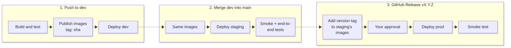

# Athlos: Architecture and Tooling Design

**Thesis:** Design and Implementation of a Multi-Tenant B2B2C Cloud-Native SaaS Platform
**Case study:** Athlos, a fitness marketplace. Coaches are tenants who open a workspace and sell programs. Customers browse and buy programs from any coach, like a big e-shop.
**Status:** v17.7, built on dev; v1.17.0 in production (2026-10-25)

**Changes in v17.7 (next release):** page crashes in the SPA are reported to Application Insights through the gateway (§6); a scheduled uptime check of staging and prod that also measures cold starts (§6); migrations follow expand, then contract, checked in CI, so a rollback runs on the newest schema (§12.2); the gateway signing key can be rotated without downtime, and secret rotation has a runbook and an expiry reminder (§3.2, §11); buyers keep a read-only copy of a program, with their progress, when its coach deletes the workspace (§2.3, §3.4); checkout asks for access right away, which ends the right of withdrawal, and keeps that consent with the Terms (new Terms version, §5.4); reporting a program or a coach, and the admin taking a program down with a reason sent to the coach (§2.3, §2.4, §5.3); refund requests: the customer asks within the refund window, the coach is emailed, and after three working days the platform admin refunds it (§2.2, §2.3, §5.3); a connection budget that fits the server: app roles share 35 connections, so pools are 2 per replica, database services run at most 2 replicas in staging and 1 in dev and prod, and the migrator caps each database (§7); demos and the evaluation run on staging (§15.3); every platform admin action states a reason and is kept in an audit trail, and a suspended coach is told the reason (§2.3, §3.4); a schema-wide RLS check and isolation cases for the last two uncovered endpoints (§3.3); the purchase end-to-end test refunds its payment at Stripe, so every staging deploy pays again (§15.1).

**Changes in v17.6 (v1.17.0):** existing workspaces accept new Terms for coaches from a notice in the studio; the owner's workspace export (§5.4).

**Changes in v17.5 (v1.16.0):** covers also at card size for the shop's cards (§2.3, §8.1); the Terms for coaches, accepted when a workspace is opened (§2.3, §5.4); an automatic check that holds reviews with contact details, links or abusive words back for the admin (§2.4).

**Changes in v17.4 (v1.15.0):** MSAL loads only when sign-in has work (§5); a coach can show one discount code on their programs, copied to catalog's `public_discounts` (§2.3, §2.4); the cart kept with the account, ordering's `carts` (§2.3, §8); `WithTenantTransaction` now sees the status inside a handler's `Results<...>` union, so an error result is never committed (it committed before, which no slice relied on).

**Changes in v17.3 (v1.14.0):** built assets cached for a year, font and config preloads, uploaded images shrunk in the browser, Lighthouse before and after (§8.1).

**Changes in v17.2 (v1.13.0):** catalog's public reads cached for 10 seconds (§4); cover links stable for 10 minutes (§2.3); robots.txt and a sitemap (§8.1); "Rate this program" in My programs and the latest reviews on the studio overview (§8).

**Changes in v17.1 (v1.12.0):** legal pages and accepting the Terms at checkout, receipts, and "Download my data" (§5.4); reporting reviews and the admin's moderation, reviews public only while their program is on sale (§2.4); a per-customer limit on writes (§4); an error boundary in the SPA (§8); emails to customers about review replies and new workouts (§5.3).

**Changes in v17 (v1.11.0):** saved programs, reviews and ratings, and discount codes (§2.4); new tables in §2.3; the `review-received` email (§5.3); the saved-programs list is a listed cross-tenant slice (§3.2).

**Changes in v16.1 (v1.10.0):** coach profiles (bio, links, uploaded logo, §3.2, §8), the coach directory, program pages with an outline and a free preview, category covers, the "Sell on Athlos" page, studio numbers and link previews (§8, §8.1).

**Changes in v16 (v1.9.0):** the full set of emails (§5.3): one purchase confirmation per checkout from ordering-api instead of one per program from enrollment-api, and the workspace's life and team (welcome, payouts ready, invite accepted, member left or removed, ownership received, suspended, reactivated, plan changed), dispute won, and account deleted; the studio's setup checklist and links to share; the refund promise on program pages (`refundWindowDays` in `/config.json`); search matches a coach's address; a deleted customer shows as "Deleted account" in the coach's sales.

**Changes in v15.5 (v1.8.1):** programs are priced in euros only; a workout's week is inside the program's length, and a program cannot be shortened below its last workout; the cart shows and totals current prices and names any that changed (§2.2, §2.3).

**Changes in v15.4 (v1.8.0):** a Stripe Connect webhook (`account.updated`) on tenancy-api keeps each workspace's "ready to sell" in step with Stripe; coaches are emailed when a payout to them fails (`payout-failed`, §2.2); starting a checkout is limited per customer at the gateway (§4); a gateway test checks that every service endpoint is routed (§15.1).

**Changes in v15.3 (v1.7.0):** the team (members listed, staff removed or leaving, ownership handed over, §5.3); a workspace is deleted only when no sale can still be refunded, and its open payment pages are closed first (§3.4); a deleted account's open payment pages are closed, and a payment that still arrives is refunded (§5.2); programs cost at least €10 (§2.3); workouts of a program that has been on sale cannot be deleted; a clear error when Stripe cannot open a payment page.

**Changes in v15.2 (v1.6.0):** coaches are emailed when a sale is refunded at Stripe or by a lost dispute, and when a customer opens a dispute (`charge.dispute.created`, §2.2, §5.3); coaches can set a public contact email, shown on their storefront and next to each order in the customer's "Orders" (§8).

**Changes in v15.1 (v1.5.1):** refund edge cases (§2.2): a refund at Stripe that arrives before the payment's own event waits for it; a coach's refund takes the coach's share back first; refunds and reversals are found again at Stripe by their order, so a retry after 24 hours does not refund twice; a dashboard refund naming an order refunds that program; no refund email to a deleted account. Prod alerts on dead-lettered messages (§5.3, §6).

**Changes in v15 (v1.5.0):** programs have a category (bodybuilding, powerlifting, CrossFit, weightlifting, calisthenics, running, mobility, general fitness) instead of a level, and the shop's header and filters use it (§8); the price filter comes first; the customer gets a refund email (§2.2, §5.3); the account menu opens each account page directly (§8).

**Changes in v14 (v1.4.0):** refunds by the coach, at Stripe or through a lost dispute, with transfer reversals and access removed (`OrderRefunded`); failed coach payouts retried, and listed for the platform admin (§2.2).

**Changes in v13 (the shop):** a cart across coaches paid in one Stripe payment, with separate charges and transfers (§2.2, ordering notes); the marketplace as an e-shop: header search and categories, filters, sorting, product cards and pages (§8).

**Changes in v12 (v0.6.0 to v1.2.0, as built):** rate limits and quotas (§4), per-coach telemetry, workbook and alert (§6), the phase 9 evaluation (`docs/evaluation/`, §15.3), workspace deletion (§3.4), customer account deletion (§5.2), the platform admin with suspension and plans (§1, §3.4), the CI contract check (§15.1), and the repo visibility decision (§16).

**Changes in v11:** the External ID tenant is linked to a separate pay-as-you-go subscription (§5, §10): the Azure for Students policy cannot allow the tenant resource, and Azure support declined an exception.

**Changes in v10 (phase 3):** RLS policies that widen reads are split per command (§3.2): the isolation suite showed that one combined policy let a public-read session reach other tenants' published rows with `UPDATE`/`DELETE`. Catalog notes added to §2.3.

**Changes in v9 (phase 2):** services validate tokens with plain `JwtBearer` instead of Microsoft.Identity.Web (§5); `statement_timeout` is set in the connection string (§4); the db-migrator runs as a Container Apps Job between two passes of `env.bicep` (§11, §12.3); a user's own memberships are a listed cross-tenant slice (§3.2).

**Changes in v8:** one shared Container Apps environment for all three stages. The student subscription allows only one Container Apps environment per region (quota `ManagedEnvironmentCount` = 1), so `cae-athlos-shared` and its VNet live in `rg-athlos-shared`, and each stage deploys its apps into it (§10, §11).

**Changes in v7:** services accept only gateway-signed requests, and each Container Apps environment runs in its own VNet. The first dev deploy showed that an app with *internal* ingress was reachable from the internet in an environment without a VNet, so network isolation alone could not carry layer 1 (§3.2, §11).

**Changes in v6:** region is **Italy North**, and the SPA is served by the gateway instead of Azure Static Web Apps. The University of Thessaly subscription only allows `italynorth`, `polandcentral`, `denmarkeast`, `belgiumcentral` and `switzerlandnorth`, and Static Web Apps is offered in none of them (§8.1, §10).

**Changes in v5:** user accounts (sign-up, email verification, password reset, profile, account deletion) and transactional email through a small notifications-worker and Azure Communication Services (§5.2, §5.3).

**Changes in v4:** added a **staging** environment. Branches stay `dev` and `main`; one build is promoted dev → staging → prod (§12). Bicep, cost, tests, CLAUDE.md and the branching and pipeline diagrams updated to match.

**Changes in v3:** added data model (§2.3), tenant lifecycle (§3.4), security checklist (§5.1), API conventions (§7.1), testing strategy, seed data and evaluation targets (§15.1 to §15.3), and a `CLAUDE.md` for the repo.

**Changes in v2:** renamed to Athlos; PostgreSQL instead of Azure SQL; dev and prod environments with a branching strategy and version tags (§12); diagrams exported as images so they read in any VS Code theme; cost re-checked (§10).

> **Diagrams** are PNG images in the `diagrams/` folder next to this file, so they look the same in any VS Code theme without extensions. Keep the folder beside this file when you move it into your repo (for example `docs/design.md` + `docs/diagrams/`). Each has a Mermaid source (`.mmd`) to edit; re-export with `npx @mermaid-js/mermaid-cli -i x.mmd -o x.png -b white -s 2`.

---

## 0. Decisions at a glance

| Area | Choice | Why |
|---|---|---|
| Backend | .NET 10 (LTS), ASP.NET Core Minimal APIs, EF Core 10 + Npgsql | Current LTS, Microsoft stack, minimal ceremony |
| Frontend | React 19 + TypeScript + Vite | Fast, standard, no framework lock-in |
| Local orchestration | Aspire (AppHost + ServiceDefaults) | One command runs everything, OpenTelemetry dashboard for free |
| Compute | **Azure Container Apps, Consumption plan** (decided) | Real containers and microservices, scales to zero, fits the budget. AKS trade-off in §9 |
| Container registry | Azure Container Registry, Standard | Azure for Students includes one Standard registry free for 12 months |
| API gateway | YARP (Microsoft, open source) as its own container app | Single entry point, tenant resolution, per-tenant rate limiting |
| Database | **Azure Database for PostgreSQL Flexible Server**, Burstable B1ms, PostgreSQL 17. One server, one database per service per environment | Azure for Students includes 750 h/month of B1ms + 32 GB storage free for 12 months. PostgreSQL has native Row-Level Security |
| Messaging | Azure Service Bus, Basic tier (queues) | About €0.04 per million operations. Standard tier costs €8.59/month |
| Identity | Microsoft Entra External ID | Free up to 50,000 monthly active users; sign-up, email verification and password reset built in |
| Email | Azure Communication Services Email, Azure-managed sender domain | Fractions of a cent per email; order and enrollment emails, staff invites |
| Payments | Stripe Connect (Express accounts) + Stripe Checkout, test mode | The B2B2C money flow: customer pays, coach gets paid, platform keeps a fee |
| Frontend hosting | Static files served by the gateway container | €0, same origin as the API (no CORS), headers set in code. Static Web Apps is not offered in the regions the subscription allows (§8.1) |
| Files (program media) | Azure Blob Storage | Pennies per month |
| Secrets | Azure Key Vault + managed identities | No connection strings or passwords in config |
| Observability | OpenTelemetry → Application Insights / Log Analytics | Vendor-neutral instrumentation, Azure backend |
| IaC | Bicep (hand-written small modules) | Native Azure, readable in a thesis |
| Region | Italy North (`italynorth`) | Closest allowed region to Greece; the subscription's policy allows only five regions (§10) |
| Environments | **dev, staging, prod** in Azure, plus local (Aspire) | Staging is a prod-like rehearsal of every release |
| CI/CD | GitHub Actions with OIDC to Azure; `dev` and `main` branches; SemVer release tags | No stored cloud secrets; build once, promote the same image dev → staging → prod |
| Tests | xUnit v3, Testcontainers, k6 for load | Real PostgreSQL in tests, tenant-isolation and noisy-neighbor experiments |
| Est. cost | **About €1 to €4 per month** while the Students free services apply | See §10 |

---

## 1. Domain and the B2B2C model


<sub>Source: [diagrams/01-b2b2c-model.mmd](diagrams/01-b2b2c-model.mmd)</sub>

Three actor types:

| Actor | Scope | Can do |
|---|---|---|
| **Platform admin** | Global | Manage tenants, plans, view platform metrics |
| **Coach** (tenant owner or staff) | One tenant | Configure workspace (name, slug, branding), create and publish programs, see own sales and own customers |
| **Customer** | Platform-wide identity | Browse all coaches, buy programs from many coaches, access purchased content, track progress |

**The B2B2C nuance worth a thesis section:** a customer is *not* inside a tenant. One customer account buys from many tenants. So data falls into three classes, and each gets its own scoping rule:

| Data class | Example | Scoping rule |
|---|---|---|
| Tenant-private | Draft programs, coach's sales report, workspace settings | Only members of that tenant |
| Tenant-owned, public | Published programs in the marketplace | Anyone can read; only the owning tenant can write |
| Customer-owned, cross-tenant | A customer's orders and enrollments | The customer sees all of their own; each coach sees only the rows for their tenant |

Core entities: `Tenant`, `Membership` (user ↔ tenant ↔ role), `Plan` (Free / Pro tier, drives quotas and rate limits), `Program`, `Workout` (program content), `Order`, `Enrollment`, `Progress`.

---

## 2. Architecture overview

Read it left to right: callers, the gateway and services, then the data stores they own.


<sub>Source: [diagrams/02-architecture-overview.mmd](diagrams/02-architecture-overview.mmd)</sub>

- Only the gateway has external ingress. All four APIs use **internal ingress** and the notifications-worker has no ingress at all, so the internet cannot reach them directly.
- The gateway also serves the SPA's static files (§8.1), so the browser talks to one origin.
- Not drawn, to keep the picture readable: the SPA signs users in with **Entra External ID**; ordering-api creates Checkout sessions on **Stripe**; every container app pulls its image from **Container Registry**, reads secrets from **Key Vault** with a managed identity, and sends OpenTelemetry data to **App Insights**; a **db-migrator** Container Apps Job applies migrations and RLS policies on each deploy.

### 2.1 Services

Four business services, a gateway and one small background worker for email. That is enough to show real microservice concerns (independent deploys, own data, async events) without bloat.

| Service | Owns | Key endpoints | Database |
|---|---|---|---|
| **gateway** | Routing, auth check, tenant resolution, per-tenant rate limits | All public traffic | none |
| **tenancy-api** | Tenants, memberships, plans, branding, Stripe connected-account id | Sign up as coach, workspace settings, Stripe onboarding link, internal membership lookup, platform admin (workspaces, status, plans) | `athlos_tenancy` |
| **catalog-api** | Programs, workouts, prices, publish state, media | Coach CRUD (tenant-scoped), public marketplace search (cross-tenant, published only) | `athlos_catalog` |
| **ordering-api** | Orders, Stripe Checkout sessions, Stripe webhooks, outbox | Create checkout, webhook receiver, customer "my orders", coach "my sales" | `athlos_ordering` |
| **enrollment-api** | Enrollments, progress | Customer "my programs", progress updates; consumes `OrderPaid` | `athlos_enrollment` |
| **notifications-worker** | Transactional email | No HTTP API; consumes the `notifications` queue and sends email through Azure Communication Services. Scales from zero on queue length | none |

Rules that keep it clean:
- **Database per service.** Each service has its own database and its own PostgreSQL login, which has no rights on the other databases.
- **Sync calls only where needed** (gateway → service, ordering → catalog for price lookup). Everything else is an event.
- **Vertical slices inside each service.** One folder per feature (`Features/Programs/CreateProgram.cs`), not layers of interfaces. No MediatR, no repositories on top of EF Core.

### 2.2 Main flow: buying a program


<sub>Source: [diagrams/03-checkout-flow.mmd](diagrams/03-checkout-flow.mmd)</sub>

**The cart (as built, v1.3.0).** Customers shop like in an e-shop: they put programs from any coaches in a cart and pay **once**. One payment cannot be a destination charge to several coaches, so checkout uses Stripe's **separate charges and transfers**:
- the customer pays the platform, in one Checkout Session for the whole cart;
- after payment, the webhook sends each coach their share (price minus the platform fee) as a Transfer to their Connect account, tied to the charge with `source_transaction`.

The trade-off: the platform is the merchant of record, so refunds and disputes are the platform's to handle; the coach's share is then taken back with a transfer reversal. "Buy now" on a program page is a cart of one.

**Refunds, disputes and coach payouts (as built, v1.4.0).** The platform holds the money between the customer and the coaches, so it also gives money back and makes sure coaches get paid.
- *Ways a paid order is refunded.* The coach refunds a sale in the studio (`POST /api/v1/studio/{slug}/sales/{orderId}/refund`, owners only, within the refund window: `Payments:RefundWindowDays`, default 14 days after payment, the EU's withdrawal period for online purchases; each sale in the list carries `refundableUntil`), or the platform refunds a whole payment in the Stripe dashboard (`charge.refunded`), or a dispute is lost (`charge.dispute.closed`, status `lost`). A partial refund (`charge.refunded`, not fully refunded) refunds the orders its refunds name in their `athlos_order_id` metadata: Athlos' own refunds carry it, and a refund made in the dashboard does when it is given one; a refund without it is logged for a person to settle.
- *Refund requests (v1.18.0).* The refund page promises that every program can be refunded within the window, so the customer asks on the order in "Orders" (`POST /api/v1/me/orders/{orderId}/refund-request`, optional note, within `Payments:RefundWindowDays` of payment). The order records it (`refund_requested_at`, `refund_request_note`), the coach's owners are emailed (`refund-requested`, with the note and the due date), and the request waits in `refund_requests`, a work queue of the service like `payout_retries`, due three working days later (Monday to Friday, UTC). The coach refunds it in Sales as any sale; a requested sale stays refundable after the window. Still open on its due date, the platform admin refunds it (`GET /api/v1/admin/refund-requests`, `POST .../{orderId}/refund` with a reason in the audit trail, §3.4). The admin's refund tries to take the coach's share back first, like the coach's, but keeps the promise if Stripe refuses: the customer is refunded and the error is logged to settle with the coach. Any refund of the order, whoever makes it, closes the request. The customer's own order is found across coaches, like the orders list, and changed inside its tenant (a listed cross-tenant slice, §3.2). Deleting the account clears the note.
- *One routine for all four* (`OrderRefunds`):
  1. the money at Stripe:
     - a coach's refund reverses the coach's transfer *first*, then refunds the customer. If Stripe refuses the reversal (for example, the coach's balance cannot cover it), nothing has changed and the studio answers `409`, so the platform never pays a refund the coach's share does not cover;
     - a refund made at Stripe or a lost dispute has already returned the money; the reversal follows, and if Stripe refuses it the order is refunded anyway and the error is logged for a person to settle with the coach;
     - a share never transferred (waiting in `payout_retries`) is dropped instead;
  2. inside the order's tenant, in one transaction: `Paid → Refunded` (once), `OrderRefunded` and the customer's refund email to the outbox (no email to a customer who deleted their account).

  enrollment-api receives `OrderRefunded` on its own `order-refunded` queue and removes the access that order gave, inside the order's tenant (its progress cascades). Every step is idempotent per order, at Stripe too: before refunding or reversing, the existing refund (by its `athlos_order_id` metadata) or reversal is looked up, because Stripe's idempotency keys last only 24 hours.
- *Telling the coach.* A refund the coach did not make (by the admin, at Stripe, or a lost dispute) emails the workspace's owners (`sale-refunded`, with the reason) in the same transaction. A dispute opened (`charge.dispute.created`) emails them too (`sale-disputed`): nothing else changes until it closes, the customer keeps the program, and a lost dispute then refunds as above. The coach's own refund in the studio sends them nothing.
- *Customers reaching the coach.* Refunds are the coach's to give, so a coach can set a public contact email in the studio settings (`branding.contactEmail`, never the owners' sign-in addresses); the storefront and each order in "Orders" link to it.
- *Events out of order.* If the payment's own event failed (a cold start, say) and Stripe is still retrying it, a refund or lost dispute for that payment can arrive first. Its orders are still `Pending`, so the webhook answers `500` and Stripe sends the refund again later, after the payment is recorded. Otherwise the late payment event would hand out access and the coach's share for money already returned.
- *Orders paid before the cart* (destination charges) are refunded in the Stripe dashboard, which reverses their transfer and updates Athlos through `charge.refunded`.
- *Coach payouts that fail.* A transfer refused after payment (for example, a restricted Connect account) no longer only logs. The order is Paid, because the customer paid, and the share goes to `payout_retries`:
  - *Retries.* A work queue of the service, like the outbox, retried with backoff (5 minutes, doubling to 6 hours). Each retry enters the order's tenant to read it.
  - *The coach is told.* The first failure emails the workspace's owners (`payout-failed`) with a link to the studio, whose overview reads the account's status from Stripe and offers to continue the setup.
- *Coach accounts that change.* A second Stripe endpoint, a Connect endpoint with its own secret (`stripe-connect-webhook-secret`), sends `account.updated` to tenancy-api's `POST /webhooks/stripe-connect`. It reads the account's status from Stripe again (so events out of order cannot set an old state) and stores it on the workspace holding the account: a restricted account stops selling at once (checkout finds no payout account), a fixed one sells again without the coach visiting the studio. All stages share one Stripe test account, so each stage also receives the others' account events and ignores accounts it does not hold.
  - *Admin.* The platform admin's page lists what waits (`GET /api/v1/admin/payouts`, ordering-api) and can retry one at once (`POST /api/v1/admin/payouts/{orderId}/retry`).
  - *No cross-tenant read.* The row carries what the list needs, so the admin never reads tenants' orders across tenants.

### 2.3 Data model essentials

Enough for the first migrations. Every table has `id uuid` (UUIDv7 via `Guid.CreateVersion7()`, so inserts stay index-friendly), `created_at` and `updated_at`. **T** marks tenant-owned tables that carry `tenant_id` and an RLS policy.

| Service | Table | Key columns |
|---|---|---|
| tenancy | `tenants` | `slug` (unique), `display_name`, `status` (Active, Suspended, Deleted), `plan` (Free, Pro), `branding` (jsonb: linked logo URL, uploaded logo path, colors, public contact email, bio, Instagram, YouTube and website links), `stripe_account_id`, `stripe_onboarding_complete`, `coach_terms_version`, `coach_terms_accepted_at`, `coach_terms_accepted_by` (the Terms for coaches accepted when the workspace was opened, §5.4) |
| tenancy | `memberships` **T** | `user_id` (Entra object id), `role` (Owner, Staff) |
| tenancy | `user_profiles` | `user_id` (unique), `email`, `display_name` |
| tenancy | `staff_invites` **T** | `email`, `token_hash`, `expires_at`, `accepted_at` |
| tenancy | `content_reports` | `kind` (Program, Coach), `tenant_id`, `program_id`, `subject` and `coach_slug` (copies for the admin), `reporter_id`, `reason`, `note`, `reported_at`, `resolved_at`, `outcome`. A work queue of the service (allow-all policy, like `payout_retries`, §2.4) |
| catalog | `programs` **T** | `title`, `slug`, `description`, `category`, `duration_weeks`, `price_amount` (integer cents, at least 1,000: €10), `currency` (`EUR` only: one currency per cart; the data model keeps a code for later), `is_published`, `cover_image_path`, `cover_card_path` (the same cover 800 px wide, for cards, §8.1), `rating_count`, `rating_average` (copies from enrollment-api, §2.4), `blocked_at` (taken down by the platform admin after a report; it cannot be published until allowed back, §2.4) |
| catalog | `workouts` **T** | `program_id`, `week`, `day`, `title`, `content` (Markdown), `video_url` |
| ordering | `orders` **T** | `customer_id`, `customer_email`, `program_id`, `program_title` (copy at purchase time), `amount`, `currency`, `platform_fee`, `status` (Pending, Paid, Failed, Refunded), `stripe_checkout_session_id` (shared by a cart's orders), `checkout_id`, `seller_account_id` (the coach's Connect account at checkout), `stripe_transfer_id`, `stripe_payment_intent_id`, `refunded_at`, `discount_code`, `discount_amount` (§2.4), `refund_requested_at`, `refund_request_note` (the customer's request, §2.2) |
| ordering | `refund_requests` | `order_id` (primary key), `tenant_id`, `coach_slug`, `program_title`, `amount`, `currency`, `requested_at`, `due_at`. A work queue of the service (allow-all policy, like `payout_retries`): the requests the admin may refund once due, with no customer's data (§2.2) |
| ordering | `payout_retries` | `order_id` (primary key), `tenant_id`, `coach_slug`, `amount`, `currency`, `attempts`, `next_attempt_at`, `last_error`. A work queue of the service (allow-all policy, like the outbox) |
| ordering | `checkouts` | `customer_id`, `idempotency_key` (unique per customer), `stripe_checkout_session_id`, `checkout_url`. The customer's, not a tenant's: RLS `customer_id = app.user_id` |
| ordering | `carts` | `customer_id` (the key: one each), `lines` (jsonb: program id, coach and program slugs, title, price, currency, category as the shop showed them). The customer's: RLS `customer_id = app.user_id` (§8) |
| ordering | `processed_stripe_events` | `stripe_event_id` (primary key, for webhook idempotency) |
| ordering | `outbox_messages` | `type`, `payload` (jsonb), `occurred_at`, `sent_at` |
| enrollment | `enrollments` **T** | `customer_id`, `program_id`, `order_id` (unique, for idempotency), `customer_email` and `update_emailed_at` (v1.12.0, §5.3) |
| enrollment | `workout_progress` **T** | `enrollment_id`, `workout_id`, `completed_at` |
| enrollment | `reviews` **T** | `enrollment_id` (unique), `customer_id`, `program_id`, `rating` (1 to 5), `comment`, `author_name`, `reply`, `replied_at`, `hidden_at` (§2.4) |
| enrollment | `program_copies` **T** | `program_id` (the key), `coach_slug`, `title`, `description`, `category`, `duration_weeks`, `workouts` (jsonb), `copied_at`: the buyers' copy of a deleted coach's program (§3.4) |
| enrollment | `review_reports` | `review_id`, `reporter_id` (unique together), `reason`, copies for the admin, `resolved_at`. A work queue of the service (allow-all policy, like `payout_retries`, §2.4) |
| tenancy, enrollment, ordering | `admin_actions` | `admin_id`, `action`, `tenant_id`, `subject`, `detail`, `reason`, `at`: each service's audit trail of the platform admin's actions it carried out (allow-all policy, like `payout_retries`; no customer's personal data, §3.4) |
| catalog | `saved_programs` | `customer_id`, `program_id` (unique together). The customer's: RLS `customer_id = app.user_id` (§2.4) |
| catalog | `public_discounts` **T** | `tenant_id` (the key: one per workspace), `code`, `percent_off`, `program_id`, `expires_at`: a copy of the code the coach shows in the shop, from ordering-api; public-read for SELECT, written only in its tenant (§2.4) |
| ordering | `discount_codes` **T** | `code` (unique per tenant), `percent_off`, `program_id`, `expires_at`, `max_redemptions`, `is_active`, `is_public` (§2.4) |

Catalog notes (phase 3):
- `programs.coach_slug` is a copy of the owning workspace's slug, taken from the gateway-verified route when the program is created. Marketplace results link to `/c/{slug}` without catalog reading tenancy's database; slugs never change, so the copy cannot go stale.
- `workouts` are the paid content: no public-read policy. Only the owning tenant reads them; enrolled customers get them through enrollment-api (enrollment notes below).
- Cover images: `PUT /api/v1/studio/{slug}/programs/{id}/cover` takes the image as the request body (JPEG, PNG or WebP, recognised by their first bytes, not the claimed `Content-Type`; at most 2 MB). The blob path is `tenants/{tenantId}/programs/{programId}/cover-{uuid}.{ext}`, built from `ITenantContext`; a new name per upload avoids stale caches, and the old blob is deleted. Every program response carries `coverImageUrl`, a read-only SAS link for that one blob, valid 10 to 20 minutes (since v1.13.0 the expiry is rounded to a 10-minute window, so the link is the same for everyone in that window and browsers cache the image instead of downloading it under a new address on every page): a user-delegation SAS in Azure (the storage accounts have shared-key access disabled), a shared-key SAS against Azurite locally.
- Deleting a program: only one that was never on sale. `first_published_at` is set on the first publish and never cleared (unpublishing clears `published_at`), because customers keep access to what they bought (§3.4); a program that has been on sale can be unpublished, not deleted. Found in phase 6: the earlier rule ("only drafts") let a coach delete a sold program after unpublishing it.
- Publishing requires an active workspace with finished Stripe onboarding (§3.4): catalog asks tenancy-api's `GET /internal/tenants/{id}/payout-account` with a signed service-to-service call (`SignedRequestHandler`, the same HMAC as the gateway's, no tenant headers). A suspended tenant's programs leave the marketplace with the tenant lifecycle (§3.4).

Ordering notes (phase 4):
- **Checkout** (`POST /api/v1/orders/checkout`, `{ programIds }` with 1 to 10 programs from any coaches, optional `Idempotency-Key`):
  - *Checks.* The buyer is not in any coach's tenant. Each program's tenant comes from catalog-api's signed answer (`GET /internal/programs/{id}/offer`, published programs of active coaches only), never from the request.
  - *Refusals.* Every coach must have an active, onboarded payout account, the cart must be in one currency, the buyer must not be an owner or staff of a coach's workspace (tenancy's membership lookup; found on dev: a coach could buy their own program, paying the fees to themselves), and no program may already be owned. Otherwise nothing is created, and the `ProblemDetails` carries a `reason` (`notForSale`, `currencies`, `cannotSell`, `ownWorkspace`, `owned`) and the `programIds` at fault, which the cart drops or flags.
  - *Writes.* Stripe creates one Checkout Session for the cart first, with `transfer_group` set to the checkout id and one `athlos_order_{i}` = `{tenant}:{order}` metadata entry per program. Then the customer's `checkouts` row (holding the Idempotency-Key) and one `orders` row per program are written. Each order goes inside its coach's tenant, one tenant at a time (`InTenantAsync`), so the EF filter and RLS check every insert. Creating the session first means a failure never leaves an order pending without a payment page.
  - *Fee.* `Payments:PlatformFeePercent`, default 10 %, per order.
- **Webhook** (`POST /webhooks/stripe`, through the gateway). Stripe.net verifies `Stripe-Signature` with a 5-minute tolerance. Then, for each (tenant, order) pair in the session's metadata, inside that tenant, so a signed event naming another tenant finds nothing:
  1. it transfers the coach's share, with idempotency key `transfer-{order}`;
  2. in one transaction, it marks the order `Paid` only if it is still `Pending` (a conditional update, so concurrent deliveries change it once) and writes `OrderPaid` and the sale email to the outbox;
  3. finally, it records the event id, so a retry returns at once.
  - *Retries and failures.* Every step is idempotent, so an event that fails halfway is completed by Stripe's retry. If a coach's transfer fails (for example a restricted Connect account), the order is still Paid, because the customer has paid. The error is logged, and the share waits on a Paid order without `stripe_transfer_id`.
  - *A program is paid once.* Found on dev (11 October 2026): a customer opened three checkout pages for one program and paid two, because checkout only refused programs already *paid*. Now a new checkout first expires the customer's older, still-open Stripe sessions for the same programs (`POST /v1/checkout/sessions/{id}/expire`); if one was paid meanwhile, the program counts as owned (409, `owned`). As a safety net, the webhook refunds an order for a program the customer already owns (Stripe refund of that line, reason `duplicate`, idempotent per order), marks it `Refunded` and transfers nothing for it.
  - *Older sessions.* Sessions from before the cart (destination charges, `athlos_order_id`/`athlos_tenant_id` metadata) still complete, with nothing to transfer.
- **Outbox** (`Athlos.Messaging`): `outbox_messages` rows are claimed with `FOR UPDATE SKIP LOCKED`, sent to the Service Bus queue, then marked sent. At-least-once; consumers dedupe on `OrderId`.
- **Reads**: `GET /api/v1/me/orders` (the customer's orders across coaches, a listed cross-tenant slice, RLS reads on `customer_id = app.user_id`) and `GET /api/v1/studio/{slug}/sales` (the tenant's paid orders).

Enrollment notes (phase 5):
- **OrderPaid → enrollment**: enrollment-api receives `OrderPaid` from the `order-paid` queue (`Athlos.Messaging` `QueueConsumer`: completed after the handler succeeds, abandoned and retried on failure, dead-lettered when unreadable or after `maxDeliveryCount`). The handler enters the tenant named in the event, which ordering-api took from catalog's offer, and inserts the enrollment; unique indexes on `order_id` and on `(customer_id, program_id)` make redelivery a no-op. `OrderPaid` carries `CoachSlug`, copied like `ProgramTitle`.
- **Who may read a workout** (this was not decided before phase 5): enrollment-api decides, catalog serves. `GET /api/v1/me/programs/{programId}` finds the caller's own enrollment, then calls catalog's `GET /internal/tenants/{tenantId}/programs/{programId}/content` with a signed service-to-service call, naming the tenant from that enrollment. Catalog enters that tenant and reads the program and its workouts under the normal tenant filter and RLS, so it needs no knowledge of customers, and naming the wrong tenant finds nothing. The content is served whether or not the program is still published, so customers keep what they bought (§3.4); a program the coach deleted is gone (`404`, the enrollment stays in the list).
- **Progress**: `PUT`/`DELETE /api/v1/me/programs/{programId}/workouts/{workoutId}/completion` (idempotent, `204`). The customer's enrollment is read first (their own rows), the workout must belong to the program (catalog's content), then the write enters the enrollment's tenant, so writes stay inside one tenant as everywhere else. A composite foreign key `(enrollment_id, tenant_id, customer_id)` makes PostgreSQL refuse a progress row that does not match its enrollment.
- **Reads**: `GET /api/v1/me/programs` (a listed cross-tenant slice, like "my orders": RLS reads `enrollments` and `workout_progress` on `customer_id = app.user_id`). All customer reads go through one file, `MyEnrollments.cs`.
- **Scaling**: besides the HTTP rule, enrollment-api has a KEDA `azure-servicebus` rule on `order-paid` (5 messages per replica), authenticated with its own managed identity, so a paid order wakes it from zero (§4, row 4).

Workout videos are links to an external host (for example unlisted YouTube or Vimeo), not files in Blob Storage: streaming video from Azure would cost bandwidth and needs transcoding. Blob Storage holds images and small PDFs only.

Money is always integer minor units plus a currency code, never `decimal` floats in JSON. Services refer to each other's data by id only; ordering copies the title and price it needs at purchase time instead of joining across services.

### 2.4 Saved programs, reviews and discount codes (v1.11.0)

Three things every e-shop has. Each lives in the service that already owns the data it depends on, so no service reads another's database.

**Saved programs (a wishlist), catalog-api.**
- *Data.* `saved_programs` (`customer_id`, `program_id`, unique together; the foreign key to `programs` cascades). The customer's rows, not a tenant's, like ordering's `checkouts`: one RLS policy, `customer_id = app.user_id`, for every command.
- *Routes.* `GET /api/v1/me/saved` lists the saved programs that are still on sale, newest saved first, as shop cards. `PUT` and `DELETE /api/v1/me/saved/{programId}` save and unsave (`204`, idempotent). Only a published program of an active coach can be saved (`404` otherwise), and a customer keeps at most 100.
- *Reading.* The list joins the customer's rows to programs in the public-read scope, so RLS shows the customer's own rows and published programs only (a listed cross-tenant slice, §3.2). A program that leaves the shop disappears from the list and comes back if it is published again. A deleted program's rows go with it (the cascade).
- *Account deletion.* tenancy-api also calls catalog-api's `DELETE /internal/customers/{id}` (§5.2).

**Reviews and ratings, enrollment-api.**
- *Who reviews.* Only a customer who owns the program: the review hangs on their enrollment. One review per enrollment, 1 to 5 stars and an optional comment (up to 2,000 characters), shown with the reviewer's first name and initial from their token's `name` claim (copied, like order titles). The customer edits or deletes it.
- *Data.* `reviews` **T** (`enrollment_id` unique, `customer_id`, `program_id`, `rating`, `comment`, `author_name`, `reply`, `replied_at`). A composite foreign key `(enrollment_id, tenant_id, customer_id)` to the enrollment cascades, as progress does, so a refund (`OrderRefunded`), a deleted account and a deleted workspace take the review with the access. RLS: the tenant's rows, plus reads of the customer's own rows and, in the public-read scope, every review (`AddTenantIsolationPolicy` with widened reads, so writes stay inside the tenant).
- *Routes.*
  - Customer: `PUT` and `DELETE /api/v1/me/programs/{programId}/review`; the review comes back in `GET /api/v1/me/programs/{programId}`. Writes enter the enrollment's tenant, like progress.
  - Public: `GET /api/v1/marketplace/programs/{programId}/reviews` (paged, newest first, with the average, the count and how many of each star). The gateway routes this one path to enrollment-api ahead of catalog's `marketplace/programs` route.
  - Coach: `GET /api/v1/studio/{slug}/reviews` (owners and staff, optionally one program) and `PUT`/`DELETE /api/v1/studio/{slug}/reviews/{reviewId}/reply`: one public reply per review.
- *The average in the shop.* Product cards, sorting by rating and link previews need each program's rating where programs are searched, in catalog. After every change to a program's reviews, enrollment-api computes the count and average inside the tenant and sends them to catalog-api's `PUT /internal/tenants/{tenantId}/programs/{programId}/rating` (signed), which enters that tenant and stores them on the program (`rating_count`, `rating_average`). The values are absolute, so a repeated call is harmless. A transaction-level advisory lock per program orders concurrent changes, and the call is made before the change commits: if catalog cannot be reached, the change is refused (`502`, or the queue retries a refund), so the two never drift apart for long.
- *The coach is told.* A new review emails the workspace's owners (`review-received`, through enrollment-api's outbox).
- *Moderation (v1.12.0).* The coach replies, but cannot delete a customer's review. Anyone signed in (a customer or the coach) reports a review with a reason (`POST /api/v1/marketplace/programs/{programId}/reviews/{reviewId}/report`, one report per person and review). Reports go to `review_reports`, a work queue of enrollment-api with an allow-all policy like ordering's `payout_retries`: it copies what the admin needs (program, author, rating, comment), so the platform admin's `GET /api/v1/admin/reviews/reports` reads no tenant's rows. The admin hides the review or keeps it (`POST /api/v1/admin/reviews/{id}/hide` or `/keep`), which enters the review's tenant, sets `reviews.hidden_at`, updates the program's rating like any review change, and closes the reports. A hidden review leaves the program's page and rating; its author and the coach still see it, marked.
- *Reporting programs and coaches (v1.18.0).* The notice and action the EU Digital Services Act asks of a platform. Anyone signed in reports a program on sale ("Report this program") or an active coach ("Report this coach" on the storefront), with a reason (illegal, misleading, someone else's work, abusive, other) and an optional note: `POST /api/v1/me/reports`, counted once per person and program or coach, and limited with the customer's other writes (§4). tenancy-api keeps the reports in `content_reports`, a work queue of the service; a program comes from catalog's signed offer, so only one on sale can be reported. The admin's queue (`GET /api/v1/admin/reports`) shows one entry per program or coach, and every decision states a reason (audit trail, §3.4):
  - *Take a program down* (`POST /api/v1/admin/reports/programs/{id}/unpublish`): catalog's signed `PUT /internal/tenants/{id}/programs/{programId}/block`, inside that tenant, unpublishes it and sets `blocked_at`, so the coach cannot publish it again (`409`); then the reports close and the coach's owners are emailed the reason (`program-unpublished`, the statement of reasons). Customers keep what they bought. If catalog cannot be reached, nothing changes (`502`). Taken-down programs are listed, and `.../allow` lifts the block (the coach publishes it again).
  - *Suspend a coach* with the workspace suspension (§3.4), which closes the coach's reports and emails the reason.
  - *Keep* a program or a coach (`.../programs/{id}/keep`, `.../coaches/{tenantId}/keep`): the reports close.
  - A deleted account's reports stay for the admin, without who made them.
- *Automatic check (v1.16.0)*. Every comment written or edited first passes `ReviewFilter`: an email address or a phone number (personal data), a link (spam), or a word on `Reviews:BlockedWords` (abusive; English and Greek by default, compared without case or Greek accents). A comment it catches is saved hidden, with a report from Athlos itself (reporter `00000000-…`, note "Held back by the automatic check") in the admin's queue, and emails the coach nothing. The admin keeps it (shown again) or hides it, as for any report; a later edit that the check catches holds it back again. It holds reviews back for a person to decide and never deletes one.
- *Only while on sale (v1.12.0).* A program's public reviews answer only while catalog sells it (catalog's signed offer, asked before the database is read): an unpublished program's or a suspended coach's reviews are `404` like the program.

**Discount codes, ordering-api.**
- *Data.* `discount_codes` **T** (`code`, unique per workspace, 3 to 20 capital letters, digits or dashes; `percent_off` 5 to 90; an optional `program_id`, otherwise every program of the workspace; optional `expires_at` and `max_redemptions`; `is_active`). Standard tenant isolation, no widened reads. Orders keep what was applied: `discount_code` and `discount_amount`; `amount` stays what the customer paid, so fees, transfers, refunds and the coach's numbers are all on the discounted price.
- *Coach.* `GET`/`POST /api/v1/studio/{slug}/discounts`, `PUT`/`DELETE .../discounts/{id}` (owners and staff, like prices), at most 50 codes per workspace. The list shows each code's paid uses.
- *Customer.* The cart takes one code. `POST /api/v1/orders/discount` (`{ code, programIds }`) prices the cart with it: the code is looked up inside each coach's tenant in the cart, so a code applies only to the programs of coaches who created it (two coaches may both have `SUMMER`), and the answer lists the discount on each program; a code that applies to nothing is `404`. Checkout takes the same `discountCode` and applies it the same way, again inside each tenant. The discount is the percentage of the price rounded down; the platform fee is taken from what is paid.
- *Shown in the shop (v1.15.0).* A coach can show one code on their programs (`is_public`): cards, saved programs and the program page say "20% off with SUMMER", and the program page gives the price with it. Only a code without a use limit can be shown, so it never runs out between changes; showing another takes the first off. ordering-api owns the codes; after every change to a workspace's codes, inside its tenant and before the change commits, it sends the shown code (or none) to catalog-api by a signed `PUT`/`DELETE /internal/tenants/{id}/public-discount`, like the rating copy. If catalog cannot be reached the change fails with 502 and is not committed. catalog keeps the copy in `public_discounts` (one row per workspace, split RLS policy: readable in the public-read scope, written only inside its tenant). The marketplace reads, the saved list and the program page read it within their listed cross-tenant slices and drop it once `expires_at` passes. It is only an advert: the customer still enters the code in the cart, and checkout applies it as above.
- *Limits.* A code is used when its order is Paid or still Pending (an open payment page), so `max_redemptions` cannot be passed by opening many pages; two customers paying at the same moment for the last use can both get it (accepted and documented). Checking codes counts toward the per-customer checkout limit at the gateway (§4), so codes cannot be guessed quickly.

---

## 3. Multi-tenancy design (the core of the thesis)

### 3.1 Isolation model

The thesis should describe the three standard models and justify the choice:

| Model | Description | Cost | Isolation |
|---|---|---|---|
| Silo | Database (or stack) per tenant | High | Strongest |
| Bridge | Schema per tenant, shared database | Medium | Medium |
| **Pool (chosen)** | Shared tables, `tenant_id` column on every tenant-owned row | Lowest | Enforced in code and in the database |

Pool is what a marketplace with many small coaches would use in practice, and it is the hardest to get right, which makes it the most interesting to implement. PostgreSQL makes the bridge model cheap to demo too (a schema per tenant), so "silo or bridge for a premium tier" is a good future-work section.

### 3.2 Defense in depth: four layers


<sub>Source: [diagrams/04-isolation-layers.mmd](diagrams/04-isolation-layers.mmd)</sub>

1. **Gateway: tenant resolution and membership.**
   - Tenant comes from the route for coach APIs: `/api/v1/studio/{tenantSlug}/...`. Public marketplace routes carry no tenant.
   - The gateway validates the JWT, maps slug → `TenantId` (cached with `HybridCache`), and checks the caller's membership and role via `tenancy-api` (cached about 60 s).
   - The gateway **strips** any incoming `X-Tenant-Id` / `X-User-Role` headers, then sets them itself.
   - The gateway **signs** every request it forwards: an HMAC-SHA256 over a timestamp, the method, path and query, and both trusted headers (`X-Gateway-Timestamp`, `X-Gateway-Signature`). Services reject anything without a valid signature younger than 60 s with `401`, except `/health/*` and `/version` (the platform's probes call those directly). The key is `gateway-signing-key` in each environment's Key Vault, read by the apps' managed identities; locally Aspire generates it.
   - **Why the signature and not only internal ingress:** the first deploy to dev showed that a Container Apps app with internal ingress, in an environment without a VNet, answered requests from the internet on its generated hostname. Each environment now runs in a VNet (§11) *and* services verify the signature, so a networking mistake alone no longer breaks tenant isolation. Every deploy smoke-tests this by calling tenancy-api directly and expecting anything but a 2xx.
   - Limits worth writing down: a captured signed request can be replayed for up to 60 s (all traffic is TLS, and capturing it means being inside the platform already), and the key is shared by the gateway and every service, so a compromised service could sign requests. Per-service keys or workload identity tokens (the gateway's managed identity requesting an Entra token per service) are the next step and good future work.
   - Services still validate the JWT themselves (audience and issuer). Belt and braces.
2. **Tenant context in each service.** A small shared library `Athlos.Tenancy` with a scoped `ITenantContext { TenantId?, UserId, Role }` populated by middleware. Endpoints never take `tenantId` from the request body.
3. **EF Core.**
   - Every tenant-owned entity implements `ITenantOwned { Guid TenantId }`.
   - A global query filter `e => e.TenantId == tenantContext.TenantId` is applied to all of them.
   - An override of `SaveChanges` sets `TenantId` on insert and throws if an update or delete targets another tenant's row.
   - `IgnoreQueryFilters()` is allowed only in explicitly named "cross-tenant" slices (public marketplace search, a customer's own orders and receipts, a customer's refund request, which finds their own order the same way and then changes it inside its tenant, a customer's own enrollments and progress, a user's own memberships in `GET /api/v1/me/memberships`, a customer's saved programs in `GET /api/v1/me/saved`, the public reviews of a program and reporting one, account deletion's search for a user's own memberships, orders and enrollments, which then changes them one tenant at a time, and a user's data export, which reads the same rows in each service) and is caught by a test that greps for it (`CrossTenantSliceGuardTests`).
   - Every tenant-scoped endpoint runs inside one database transaction (`WithTenantTransaction`), because the RLS settings below live only as long as a transaction. An endpoint that forgets it sees no rows at all: the failure is closed, not open.
4. **PostgreSQL Row-Level Security.** The last line, which protects even against a bug in layer 3.
   - An EF Core interceptor sets the tenant for the current transaction with `SELECT set_config('app.tenant_id', @t, true)` (and `app.user_id`, `app.scope`). The `true` makes the setting **transaction-local**, so a pooled connection can never carry one tenant's context into another request.
   - A policy on each tenant table:

   ```sql
   ALTER TABLE programs ENABLE ROW LEVEL SECURITY;
   ALTER TABLE programs FORCE ROW LEVEL SECURITY;

   -- Reads: the tenant's rows, plus published rows in the public-read scope.
   CREATE POLICY tenant_read ON programs FOR SELECT
     USING (
       tenant_id = current_setting('app.tenant_id', true)::uuid
       OR (current_setting('app.scope', true) = 'public-read' AND is_published)
     );
   -- Writes: the tenant's rows only.
   CREATE POLICY tenant_insert ON programs FOR INSERT WITH CHECK (tenant_id = current_setting('app.tenant_id', true)::uuid);
   CREATE POLICY tenant_update ON programs FOR UPDATE
     USING (tenant_id = current_setting('app.tenant_id', true)::uuid)
     WITH CHECK (tenant_id = current_setting('app.tenant_id', true)::uuid);
   CREATE POLICY tenant_delete ON programs FOR DELETE USING (tenant_id = current_setting('app.tenant_id', true)::uuid);
   ```

   - **Why four policies and not one** (an earlier version of this design had one): a policy's `USING` clause decides which rows `SELECT`, `UPDATE` *and* `DELETE` can reach, and `DELETE` has no `WITH CHECK`. With one combined policy, a session in the public-read scope could delete another tenant's published programs, and a user could delete their own membership rows in other workspaces. The isolation suite caught it (`RLS_public_read_does_not_allow_changing_As_programs`, `A_user_acting_in_B_cannot_delete_their_membership_in_A`). `RowLevelSecurity.AddTenantIsolationPolicy` writes the split form whenever reads are widened.

   - For orders, the `USING` clause also allows `customer_id = current_setting('app.user_id', true)::uuid`, which is exactly the B2B2C rule from §1: the customer sees all of their own rows, the coach sees their tenant's rows. `memberships` works the same way with `user_id`.
   - `tenants` itself: every session may read it (storefronts, slug lookup), but insert, update and delete only the row whose `id` is `app.tenant_id`. `user_profiles`: only the row of `app.user_id`.
   - Settings are read as `NULLIF(current_setting(...), '')::uuid`, so a missing tenant matches nothing.
   - **Two PostgreSQL pitfalls to handle and write about:** RLS does not apply to the table owner unless `FORCE ROW LEVEL SECURITY` is set, and it never applies to superusers or roles with `BYPASSRLS`. So the migrator role owns the tables, and each service connects as a separate, non-owner role with only `SELECT, INSERT, UPDATE, DELETE`.

**Other isolation points**
- **Blob storage:** paths are `tenants/{tenantId}/programs/{programId}/...` (catalog-api's covers) and `tenants/{tenantId}/workspace/...` (tenancy-api's coach logos, since v1.10.0), always built from the tenant in `ITenantContext`. Both services share one private container and the `Athlos.Media` building block. The APIs issue short-lived, read-only user-delegation SAS URLs, and only for content the caller is enrolled in or owns, or that is public (a cover, a logo). Deleting a workspace removes everything under its prefix.
- **Caches:** every cache key is prefixed with the tenant id.
- **Logs and traces:** `tenant.id` is on every span and log scope, so one tenant's activity can be isolated in queries (see §6).
- **Stripe:** each coach is a separate Connect account. Money never co-mingles in a way the platform has to reconcile by hand.

### 3.3 Proving isolation (evaluation chapter)

- An integration test suite (Testcontainers + real PostgreSQL 17) that, for **every** endpoint, calls with tenant B's identity against tenant A's resources and expects `404` (not `403`, which would leak existence).
- A database-level test that connects as the service role, sets `app.tenant_id` to tenant B, runs raw `SELECT *` on tenant A's rows, and expects zero rows. It also tries an `INSERT` with tenant A's id and expects a policy violation. This proves layer 4 alone holds.
- A schema-wide check (`SchemaRowLevelSecurityTests`): after the db-migrator's migrations, every table in every service database has RLS enabled, forced and at least one policy. The only exception is EF's `__EFMigrationsHistory`, and an exception may never hold a `tenant_id`. A migration that forgets its policy fails CI instead of reaching production.
- A test that turns layer 3 off (test-only flag) and shows layer 4 still blocks. Good material for the "defense in depth" argument.

### 3.4 Tenant lifecycle

| State | How it is entered | Effect |
|---|---|---|
| **Active** | Coach signs up | Workspace usable; programs can be published once Stripe onboarding is complete |
| **Suspended** | Platform admin action | Storefront and checkout return `404`; existing customers keep access to what they bought |
| **Deleted** | Owner or admin request | Tenant-private data is removed by `tenant_id` in every service (tenancy-api calls `DELETE /internal/tenants/{id}` on each service; Service Bus Basic has no topics for a broadcast), blobs under `tenants/{id}/` are deleted; orders are kept for accounting with the tenant marked deleted |

**Deletion as built:**
- *Who and how.* The owner deletes the workspace in the studio with `DELETE /api/v1/studio/{slug}/workspace`, typing the address to confirm. An admin deletion route is future work; the platform admin suspends instead (below).
- *Order of steps.*
  0. tenancy-api asks ordering-api's `POST /internal/tenants/{id}/prepare-deletion`. Sales still inside the refund window refuse the deletion (`409`, with the date the last one runs out): their customers could still ask for their money back, and only the coach can give it, so the coach refunds them or waits. Open Stripe payment pages for the workspace's programs are closed (expired), so nobody pays for a program about to be erased; a cart's page holds other coaches' programs too, and that customer starts the checkout again. A page already paid, whose event has not arrived, also refuses (`409`, try again in a few minutes).
  1. tenancy-api calls enrollment-api's `DELETE /internal/tenants/{id}`. Since v1.18.0 this keeps the buyers' programs: for each program a customer owns, enrollment-api copies its content from catalog-api (title, description, category, length and workouts, not the cover) into `program_copies`, inside that tenant, and keeps the enrollments and progress. The workspace's reviews and their reports go.
  2. It calls catalog-api's (programs, workouts, then every blob under `tenants/{id}/`). Enrollment comes first because it needs catalog's content; while catalog has not erased yet, the workspace is still Active, so a retry finishes both.
  3. In one transaction it removes the memberships and invites, and marks the tenant `Deleted`, with its name, branding and Stripe link cleared.
  - If a call fails, the workspace is still Active and the owner retries (502); every step is idempotent.
  - The slug stays taken, so no new workspace inherits old links. The coach's Stripe account is theirs and stays at Stripe.
- *Each service deletes as the tenant.* It enters that tenant before its transaction, so the EF filter and RLS both confine the delete to the one tenant. The isolation suite deletes tenant A and counts, as the superuser, that nothing of A and everything of B is left (catalog), and that A's buyers keep their copy and progress while nothing of B changes (enrollment).
- *What customers see* (decided 26 October 2026). A program bought from a deleted coach stays in "My programs": its page reads the copy once catalog no longer has the program (`coachLeft`, with a notice, no cover, no storefront link and no review form), and workouts can still be ticked off. The orders stay in ordering-api for accounting. The copy is the coach's content kept for the customers who paid for it, which the Terms for coaches say; it goes when the last buyer deletes their account.
- *Known gaps.*
  - The tenancy-api calls are not in a distributed transaction: a crash between steps leaves a partly erased but still Active workspace, which a retry completes.
  - An `OrderPaid` already in the queue when a workspace is deleted could still create an enrollment for it. Checkout is closed by then, because a non-Active workspace cannot sell.

**Suspension and plans as built (platform admin):**
- *Who.* A user with the Entra app role `Platform.Admin` (§5), set up per stage by `infra/platform_admin_setup.py`. The routes are `/api/v1/admin/...` on tenancy-api, behind an authorization policy on the token's `roles` claim; anyone else gets `403` (for every id, so nothing leaks). The SPA shows `/admin` to admins only.
- *Routes.* `GET /api/v1/admin/tenants` (search by name or address, filter by status, paged), `PUT /api/v1/admin/tenants/{id}/status` (`Active` or `Suspended`), `PUT /api/v1/admin/tenants/{id}/plan` (`Free` or `Pro`), `GET /api/v1/admin/metrics` (workspaces by status and plan, ready to sell, new in 30 days).
- *Suspending.*
  1. tenancy-api calls catalog-api's `PUT /internal/tenants/{id}/suspension`, which sets `programs.tenant_suspended` as that tenant.
  2. It marks the tenant `Suspended`.
  - If the call fails, nothing has changed (502) and the admin retries. Reactivating runs the same two steps back.
- *Effect.*
  - The storefront is `404`.
  - The marketplace search, program page and checkout's price lookup leave the programs out, so checkout is `404` too. The public-read RLS policy also requires `NOT tenant_suspended`, so layer 4 hides them on its own.
  - The studio is closed, because the gateway resolves only active workspaces (its cache can keep it open for up to a minute). The coach's workspace list marks it Suspended.
  - Customers keep what they bought: paid content is read inside the tenant, whatever its state.
- *Each write enters one tenant.* The admin has no tenant of its own. Changing a workspace's status or plan enters that tenant for the transaction, so RLS (`tenants_update`) confines the write to the one row. The isolation suite shows that suspending A leaves B active, and that B's owner cannot suspend A.
- *Plans.* A new plan applies within the gateway's 60-second cache. A downgrade keeps what the coach has; quotas only stop new programs and staff.
- *Audit trail (v1.18.0).* Every admin action states a reason (3 to 500 characters, otherwise `400` and nothing changes): suspending or reactivating a workspace, changing its plan (tenancy), hiding or keeping a reported review (enrollment) and retrying a coach's payout (ordering). The service that makes the change writes it to its own `admin_actions` in the same transaction, with the admin's id, what it concerned and the reason; a repeat that changes nothing writes nothing. The suspension email tells the coach the reason, the statement of reasons the EU Digital Services Act asks for. Each service lists its own (`GET /api/v1/admin/actions`, `/api/v1/admin/reviews/actions`, `/api/v1/admin/payouts/actions`, newest 100), and the admin page shows them together under "Recent actions". The log names programs and workspaces, never a review's author or text, so it keeps no customer's personal data.
- *Platform metrics.* The admin page shows counts from tenancy's own table (database per service). Traffic, latency, 429s and sales per coach stay in the "Athlos per coach" workbook (§6), not in a cross-database report.

Deleting one tenant's data with one key is a strong, demonstrable argument for the pool model's `tenant_id` discipline, and it is the GDPR "right to erasure" angle for the thesis. Plans (Free, Pro) are assigned by the platform admin; charging coaches a subscription through Stripe Billing is future work.

---

## 4. Noisy-neighbor protection

Goal: one tenant's spike must not degrade others. Layered, cheapest first:

| # | Mechanism | Where | Implementation |
|---|---|---|---|
| 1 | Per-tenant rate limiting | gateway | `System.Threading.RateLimiting` `PartitionedRateLimiter` keyed by `TenantId` (token bucket), limits come from the tenant's plan (Free: e.g. 20 req/s, Pro: 100 req/s). Returns `429` with `Retry-After` |
| 2 | Per-tenant concurrency limit on expensive endpoints | gateway | Concurrency limiter partitioned by tenant for search and upload routes |
| 3 | Quotas | tenancy-api + services | Max programs, max media GB, max staff by plan. Checked on write |
| 4 | Elastic scale | Container Apps | HTTP scale rule (concurrent requests) on each app, and Service Bus queue-length rules on enrollment-api and notifications-worker. Each app has `maxReplicas` set, which also caps the bill |
| 5 | Async offloading | Service Bus | Slow work (enrollment, future emails) runs off the request path |
| 6 | Resilience between services | all | `Microsoft.Extensions.Http.Resilience` standard handler: timeouts, retries with jitter, circuit breaker |
| 7 | Database protection | all | Indexes leading with `tenant_id`, `statement_timeout` of 5 s per service (in the connection string, `Options=-c statement_timeout=5000`: roles created through Entra cannot be altered by the migrator), a small connection pool per service replica within a budget for the whole server (below), hard page-size caps (max 50) |

**As built (phase 7):**
- *Whose budget a request spends.* A coach's studio routes count once the caller is confirmed a member; their storefront (`/api/v1/marketplace/coaches/{slug}/...`, and the program list with `?coach={slug}`) counts for everyone. Both share one token bucket per coach, sized by the plan's requests per second. The cross-coach marketplace search and unknown addresses are limited per client IP instead (`RateLimits:PerClientRequestsPerSecond`, 20). Signed-in customers' reads (`/me`, orders) are not rate limited. Starting a checkout, which opens a Stripe payment page and writes pending orders, is limited to `RateLimits:CheckoutsPerMinute` (10) per signed-in customer (per client IP without a sign-in), and checking a discount code shares that bucket. Since v1.12.0 a customer's other writes (anything but a read under `/api/v1/me`: reviews, saved programs, progress; and reporting a review) share `RateLimits:CustomerWritesPerMinute` (60) per customer, so one account cannot flood the services with writes.
- *Public reads cached (v1.13.0).* catalog-api caches its public marketplace reads (search, program pages) for 10 seconds in each replica's memory (`PublicReadCache`, `Marketplace:CacheSeconds`), keyed by the full address. They depend on no tenant or user, so a burst of visitors costs one database read per address per 10 seconds; studio and internal routes are never cached, and a change shows in the shop within 10 seconds. The stress test found catalog-api's single replica running out of CPU on this work (`evaluation/stress.md`).
- *How the gateway knows the plan.* `GET /internal/tenants/{slug}/plan` on tenancy-api (signed, like the membership lookup), cached for 60 s, so plan limits live only in tenancy's `Plans`.
- *Concurrency.* Cover uploads and text searches also take one of `RateLimits:ConcurrentHeavyRequests` (4) slots per coach or client.
- *Rejections.* 429 with `Retry-After` and a ProblemDetails body, counted by `athlos.ratelimit.rejected` (tags: `scope`, `tenant`, `plan`, `reason`). `RateLimits:Enabled=false` turns the limits off for the experiment's "limits off" run.
- *Quotas, checked on write (409).* Programs: catalog asks tenancy for the plan before creating one, and drafts count. Staff: tenancy counts staff members plus open invites, so an invite holds a place until it is accepted or expires. Media: not enforced separately, because it cannot be reached: one cover per program, at most 2 MB, times the program quota is 10 MB on Free (1 GB allowed) and 200 MB on Pro (20 GB).

**Known limitation (write it down):** a flood of one coach's public storefront spends that coach's budget, so their own visitors also get 429s while every other coach stays unaffected. That is the point of the experiment, but it also means one abusive client can do it on purpose. A per-client limit on storefront traffic would stop a single client, not a distributed one; it is future work, together with a CDN in front of the gateway (§8.1).

**Known limitation (write it down):** the gateway's rate limiter is in memory, so with N gateway replicas each tenant effectively gets N × the limit. The fixes are a distributed limiter on Redis (about €13+/month, over budget) or dividing the limit by the replica count. For the thesis, keep the gateway at `maxReplicas: 2` and document the trade-off.

**Experiment for the evaluation chapter** (k6, open source, run from your machine or a GitHub Actions job, against the **staging** environment, so results are not disturbed by work in progress on dev):
1. Tenant B sends a steady 10 req/s; measure its p95 latency (baseline).
2. Tenant A floods at 300 req/s. Run once with limits off and once with limits on.
3. Report tenant B's p95 and error rate in both runs, and tenant A's 429 rate. Graph it from App Insights.

First run (5 October 2026): [docs/evaluation/noisy-neighbor.md](evaluation/noisy-neighbor.md). With limits off, tenant B's p95 went from 133 ms to 11 s with 27.5% errors (catalog-api's connection pool exhausted); with limits on, B had no errors and a p95 of 193 ms (+45%, over the 20% target, explained there).

The shared B1ms database is itself a noisy-neighbor story: without limits, tenant A's flood exhausts connections and CPU credits for everyone. That makes the "limits on" result more convincing.

---

## 5. Identity and authorization

- **Where the tenant lives (decided 2026-09-28).** An External ID tenant is an Azure resource (`Microsoft.AzureActiveDirectory/ciamDirectories`) whose location follows the country: for Greece it must be **Europe**. The Azure for Students policy allows only five regions (plus `global`), Azure rejects `global` for a Greek tenant, and Azure support declined an exception. The tenant `athlos.onmicrosoft.com` (tenant id `8daab877-07e4-4546-a727-554cc0d5be80`, Europe) is therefore linked to a separate **pay-as-you-go subscription** on the author's personal account, in `rg-athlos-identity`. Nothing else runs there; External ID is free under 50,000 monthly active users. Alternatives weighed: a 30-day trial tenant (must be linked later anyway), a workforce tenant with B2B self-service sign-up (guests, no passwords), and self-hosted open source (ZITADEL fits: Go, PostgreSQL, scales to zero; Keycloak needs about 1 GB and breaks the budget).
- **Setup is code:** `infra/entra_setup.py` creates, per stage, an API app registration (scope `access_as_user`, email in access tokens) and a SPA app registration (redirect to the stage's gateway, admin-consented), plus one "Athlos sign-up and sign-in" user flow (email + password, display name). It prints the GitHub environment variables `AUTH_AUTHORITY`, `AUTH_AUDIENCE`, `SPA_CLIENT_ID`, `API_SCOPE`.
- **Microsoft Entra External ID** (the successor of Azure AD B2C) for sign-up and sign-in. Free for the first 50,000 monthly active users. Customers and coaches use the same user flow (email + password, optionally Google). One external tenant, with a separate app registration per environment (dev, staging, prod).
- The SPA uses **MSAL** (`@azure/msal-browser`, auth code + PKCE), behind a small `Auth` interface (`lib/auth.ts`). MSAL loads only when it has work: Entra's redirect back, a tab that signed in or started to, or a click on Sign in; a signed-out visitor never downloads it (63 kB compressed, v1.15.0). The gateway and services validate tokens with ASP.NET Core's `JwtBearer` handler (authority = the External ID tenant, audience = the Athlos API app registration). Microsoft.Identity.Web was the first plan; for a single External ID tenant it adds hidden scope checks and configuration without adding safety, and plain `JwtBearer` lets tests swap in a local signing key.
- **Authorization data lives in your app, not in the token.** "Who is a coach of which tenant" is in `tenancy-api` `memberships`. This keeps tokens small, avoids a custom-claims extension, and makes role changes immediate. One Entra app role, `Platform.Admin`, covers the admin: assigned to a user on the stage's API app registration, it arrives in the access token's `roles` claim (§3.4, "Suspension and plans as built").
- Becoming a coach: a signed-in user calls `POST /api/v1/tenants` → a tenant is created with them as `Owner` → they are sent to Stripe Connect onboarding (`POST /api/v1/studio/{slug}/payouts/onboarding`, owners only: creates the Express account once, returns a Stripe account link back to `/studio/{slug}`; `GET .../payouts` reads the status from Stripe and caches it as `stripe_onboarding_complete`). Without a Stripe key an environment answers `503` rather than faking onboarding.

### 5.1 Security checklist

- HTTPS only; HSTS and basic security headers (`X-Content-Type-Options`, `Referrer-Policy`, a Content Security Policy on the SPA, all set by the gateway, which serves the SPA).
- No CORS: the SPA and the API share the gateway's origin. Local development uses the Vite dev-server proxy, so CORS stays off there too.
- Stripe webhooks: verify the `Stripe-Signature` header with the signing secret, reject events older than 5 minutes, dedupe on event id.
- No secrets in the repo, ever. Local secrets live in .NET user secrets or in Aspire parameters; Azure secrets in Key Vault. GitHub secret scanning needs a public repo or paid Advanced Security; the repo is private (§16), so GitGuardian's check on every PR scans for secrets instead.
- Upload limits: content-type allow-list and size cap for media; SAS URLs expire within 20 minutes.
- Personal data is minimal: Entra holds credentials; Athlos stores user ids, display names and emails only where needed.
- The API never returns stack traces; `ProblemDetails` only, with the trace id so errors can be found in App Insights.

### 5.2 User accounts

Entra External ID does the account work, so Athlos never stores or handles passwords.

| Need | How it works | Built by |
|---|---|---|
| Sign-up | "Email with password" user flow; the email address is the sign-in name (no separate username). Optional Google sign-in | Entra, configured in the portal |
| Email verification | Entra sends a one-time code to the address during sign-up | Entra |
| Forgot password | Self-service password reset: a one-time code by email, then a new password. Enable Email OTP and the "Forgot password?" link in Company Branding | Entra |
| Password change, MFA | Entra user flow settings; MFA by email code can be switched on per user flow | Entra |
| Sign-in page look | Company Branding (logo, colors) for Athlos as a whole | Entra |
| Display name and profile | Entra collects the display name at sign-up. Athlos keeps a small `user_profiles` table in tenancy-api (`user_id`, `email`, `display_name`, `created_at`), created on first sign-in | Athlos |
| Account deletion | `DELETE /api/v1/me`: Athlos removes or anonymizes the user's data in each service, then deletes the Entra user through Microsoft Graph | Athlos |
| Coach staff invites | Owner enters an email; tenancy-api stores an invite token (valid 7 days) and queues an invite email; the invitee signs in and accepts | Athlos |

**Account deletion as built:**
- *Route.* `DELETE /api/v1/me` on tenancy-api, through the gateway. The SPA's account settings page (`/me/account`) asks the user to type "delete my account", then signs them out.
- *Owners first.* Someone who owns a workspace gets `409` naming it: they hand ownership to a staff member or delete the workspace first (§3.4, §5.3), so nothing coaches' customers paid for disappears as a side effect.
- *Order of steps.*
  1. ordering-api's `DELETE /internal/customers/{id}` closes the customer's open Stripe payment pages and anonymizes their orders (their checkouts and cart are deleted). The orders stay for the coaches' accounting, with the email replaced by `erased@deleted.invalid`; the customer id that stays is the object id of an Entra user that no longer exists. A page paid in the moment before it closed is refunded by the webhook, without access or a payout, because its order has no address left.
  2. enrollment-api's `DELETE /internal/customers/{id}` erases enrollments and progress (and, since v1.11.0, the reviews on them), and catalog-api's erases saved programs (§2.4).
  3. tenancy removes the user's staff memberships and the invites sent to them, then their profile.
  4. Last, Microsoft Graph deletes the Entra user.
  - Every step is idempotent: if one fails, the user is told and retries (502). A failure before step 3 leaves tenancy untouched; a Graph failure leaves only the sign-in account, which the retry removes.
- *One tenant at a time.* Each service finds the tenants that hold the user's rows (a listed cross-tenant read, RLS `customer_id = app.user_id`), then changes them inside each tenant (`TenantScopes.InTenantAsync`), so the writes go through the tenant filter and RLS like any other.
- *Graph access.* A per-stage app registration in the External ID tenant, "Athlos account deletion (stage)", with the application permission `User.ReadWrite.All`. Its client secret (2 years) is in the stage Key Vault as `entra-deletion-client-secret`, and its client id is the `ACCOUNT_DELETION_CLIENT_ID` GitHub environment variable; `infra/account_deletion_setup.py` creates all three. Where it is not set up, the endpoint answers 503 and deletes nothing.
- *Known gaps.*
  - Invites sent to the user's address by workspaces they never joined stay until they expire or are revoked; the user's own rows cannot reveal which tenants those are.
  - Data at Stripe (the email on past Checkout sessions) follows Stripe's retention, outside Athlos.
  - Entra soft-deletes: a deleted user stays in the tenant's deleted items for 30 days, then is removed for good (seen on dev, 10 October 2026). Purging it at once is one more Graph call, `DELETE /directory/deletedItems/{id}`; future work.
- *Tested end to end on dev* (10 October 2026, a throwaway account, one trace of 2.8 s): ordering 204 (172 ms), enrollment 204 (246 ms), Graph token 200, `DELETE /users/{id}` 204; afterwards Graph answers `Request_ResourceNotFound` for that user.

Things to know and write down in the thesis:
- Entra's own emails (verification and reset codes) come from a Microsoft sender with Athlos branding. Sending them from your own domain needs a custom email provider extension; that is out of scope.
- Branding of the sign-in pages is per platform, not per coach. Per-tenant branding lives in the Athlos app itself (the storefront).
- Changing the sign-in email address is not offered in v1; the user can create a new account.

### 5.3 Transactional email

Emails Athlos itself sends, all through the `notifications` queue:

| Trigger | Recipient | Email | Queued by |
|---|---|---|---|
| Order paid | Customer | Purchase confirmation and link to the program | enrollment-api, after it creates the enrollment |
| Order paid | Coach (tenant owners) | "You made a sale" | ordering-api |
| Staff invite | Invitee | Invite link | tenancy-api |
| Stripe onboarding incomplete after 3 days (optional) | Coach | Reminder | tenancy-api |

- **Service:** Azure Communication Services Email with an **Azure-managed domain** (`...azurecomm.net` sender, no DNS setup). A custom domain can be added later if you own one. Stripe also emails its own receipts to customers in live mode; test mode does not.
- **Message:** `{ type, to, locale, templateData }`. The worker renders HTML and plain-text templates kept in the repo (Razor or simple Liquid-style templates) and calls the ACS SDK with its managed identity.
- **Delivery guarantee:** at least once. A rare duplicate email is accepted and documented; the worker keeps no database. Failed sends retry through Service Bus and end in the dead-letter queue, which prod's dead-letter alert watches (§6).
- **Local development:** the worker writes emails to the console and to a local folder instead of sending them, so no real email leaves your machine; dev and staging can use the same "sink" mode.
- **Privacy:** email addresses are passed in the message only; they are not logged, and the `to` field is redacted in traces.

Built in phase 5:
- **Contract** (`Athlos.Messaging.Contracts.EmailNotification`): `{ template, to, toOwnersOfTenant, locale, data }`. Services write it to their outbox in the same transaction as the change it announces: ordering-api with the order turning `Paid` (sale email), with a refund (refund email to the customer, and to the coach when they did not make it) and with a dispute opened (dispute email to the coach), enrollment-api with the enrollment (purchase email, so it is sent once access exists, and only once per order).
- **Every email** (v1.9.0), by who receives it:
  - *Customer:* `purchase-confirmation`, one per checkout, queued by ordering-api after the checkout's orders are Paid, listing each program, the total and the refund window (a crash between the orders and the email loses the email, never an order or its access); `refund-confirmation`; `account-deleted`, the last one, queued with the profile's deletion.
  - *Coach's owners* (`toOwnersOfTenant`): `review-received` (enrollment-api, v1.11.0), `sale-made`, `sale-refunded`, `sale-disputed`, `dispute-won`, `payout-failed`, `refund-requested` (ordering-api); `workspace-welcome`, `payouts-ready` (the first time Stripe confirms the account, from the studio's status read or the Connect webhook), `invite-accepted`, `member-left`, `ownership-received` (sent when the worker sends it, so to the new owner), `workspace-suspended`, `program-unpublished`, `workspace-reactivated`, `plan-changed` (tenancy-api).
  - *Others:* `staff-invite` to the invitee, `member-removed` to the removed member's profile address.
  - *Customers again* (v1.12.0, enrollment-api, which keeps the buyer's address on the enrollment from `OrderPaid`; enrollments from before have none and get nothing): `review-replied` when the coach first replies to their review; `program-updated` when the coach adds a workout to a program that has been on sale, at most once a day per customer (`update_emailed_at`). Catalog-api has no outbox, so after the new workout commits it calls enrollment-api's signed `POST /internal/tenants/{tenantId}/programs/{programId}/updated` (best effort: a failure is logged and the workout stays saved).
  - Catalog-api sends no email itself (it has no outbox): a published program's link is offered in the studio instead.
- **Coach recipients** (this was not decided before phase 5): the sale email names the tenant (`toOwnersOfTenant`), not addresses. The worker asks tenancy-api `GET /internal/tenants/{id}/owner-emails` (signed) when it sends, so ordering never handles coaches' addresses and the email reaches whoever owns the workspace at that moment. Tenancy enters that tenant to answer; a SELECT-only policy `tenant_members_read` on `user_profiles` lets a tenant session read the profiles of that tenant's members (writes still need `own_profile`). The customer's address is not in the sale email.
- **Worker**: renders `Templates/{name}.txt` (first line `Subject: ...`) and `{name}.html` with `{{key}}` placeholders (HTML-encoded in the HTML part; a missing key fails the message, which retries and dead-letters), and sends one email per recipient so owners never see each other's addresses. `Email:Mode` is `Acs` in Azure and `Sink` locally (files in `src/AppHost/.emails`).
- **Azure**: `acs-athlos-{env}` and `ecs-athlos-{env}` (Communication Services and Email Communication Services) are global resources with data in Europe; the region policy exempts `global` (§10). The worker's container app has no ingress and scales from zero on the `notifications` queue (KEDA `azure-servicebus`, its own identity).
- **Staff invites** (§5.2, built at the end of phase 5): the owner invites an address (`POST /api/v1/studio/{slug}/invites`; list and revoke next to it; owners only). tenancy-api stores only a SHA-256 hash of a random 256-bit token, valid 7 days, and queues the `staff-invite` email through its outbox. Inviting the same address again replaces the open invite; inviting a member is a `409`.
  - **The link is `/invites/{slug}#{token}`** (this was not decided before): the token is in the URL fragment, which browsers never send to a server, so it stays out of gateway and proxy logs. The SPA posts it in a request body.
  - **Accepting** (`POST /api/v1/invites/{slug}/accept`): the invitee is not a member, so the gateway resolves no tenant; the slice enters the workspace named by the slug, like `CreateTenant`, and looks the invite up there by the token's hash under RLS. The token decides, not the slug: another workspace's slug finds nothing. Only the signed-in user whose verified email equals the invited address can accept (a forwarded link is useless to anyone else), once; anything else is `404`. The user becomes `Staff`.
  - `staff_invites` has the standard tenant isolation policy (no widened reads).
- **The team** (v1.7.0): `GET /api/v1/studio/{slug}/members` lists the members to every member, with addresses for the owner only (profiles are readable inside the tenant, `tenant_members_read`). `DELETE .../members/{userId}` removes a staff member (owner) or leaves (staff, naming themselves). The owner cannot leave (`409`): `POST .../members/{userId}/ownership` hands ownership to a staff member, swapping the two roles in one transaction, so a workspace always has exactly one owner. The same transaction disconnects the workspace's Stripe account (`stripe_account_id`, onboarding flag): it belongs to the person who set it up and pays out to their bank, so the new owner's sales must not reach it. Sales pause (checkout finds no payout account) until the new owner sets up payouts with their own account. Earlier orders name the account they pay (`seller_account_id`), so their pending payouts and refunds stay with the previous owner. Everything runs inside the tenant, so another tenant's member is `404` (isolation suite). The gateway caches memberships for up to 60 seconds, so a removed member or a former owner keeps their old access for at most a minute.

### 5.4 Terms, receipts and personal data (v1.12.0)

What a shop taking real money from EU customers needs besides the payment itself.
- *Legal pages.* `/legal/terms`, `/legal/privacy`, `/legal/refunds` and `/legal/coaches` (the Terms for coaches, v1.16.0), linked from the footer, say what the platform does: who sells (the coach), who is paid (the platform, which passes each coach their share), the refund window, what data goes to Microsoft and Stripe, and what deleting an account erases. They are SPA pages; a lawyer would review them before live payments (`limitations.md`).
- *Accepting the Terms.* The cart asks the customer to tick "I accept the Terms and the Refund policy"; "Buy now" says that buying accepts them. Each checkout sends the version shown (`termsVersion`, the SPA's `lib/legal.ts`), and ordering-api refuses any version but `Legal:TermsVersion` (`409`, reason `terms`), so nobody pays under terms they were not shown. The `checkouts` row keeps `terms_version` and `terms_accepted_at` as evidence.
- *The right of withdrawal (v1.18.0).* EU law gives 14 days to withdraw from an online purchase; for digital content it ends when access starts only if the buyer expressly asks for access right away and acknowledges losing the right. The cart asks for it with a second box ("I want access right away, and understand that my right of withdrawal then ends"), and "Buy now" says so next to the Terms. Each checkout sends `immediateAccess`; without it ordering-api refuses (`409`, reason `withdrawal`). The checkout keeps `immediate_access_consent_at` next to the Terms version, and the data export lists it. Athlos's refund window still applies. The Terms went to version 2026-10-26 to say so; a lawyer's review of the wording waits until after the thesis (backlog item 14).
- *Terms for coaches (v1.16.0).* Opening a workspace (`POST /api/v1/tenants`) ticks "I accept the Terms for coaches" and sends the version shown (`termsVersion`); tenancy-api refuses any version but `Legal:CoachTermsVersion` (`409`, reason `terms`). The workspace keeps the version, the time and the user who accepted, and that user's data export shows them. The coach terms say what the platform does with a seller: the fee, payouts to the coach's own Stripe account, refunds and lost disputes taking the coach's share back, content rules, suspension, and what deleting a workspace means for customers. A workspace that has not accepted the version in force (opened before v1.16.0, or the terms changed since) gets a notice in the studio (`GET .../workspace` returns `coachTermsVersion` and `coachTermsCurrent`, v1.17.0); its owner accepts there with `POST /api/v1/studio/{slug}/workspace/coach-terms`, which checks the version the same way and records it, and staff are told the owner needs to. Selling is not blocked meanwhile (`limitations.md` 2).
- *Receipts.* `GET /api/v1/me/orders/receipts/{checkoutId}` (ordering-api, in the "customer's own orders" slice) gives one checkout's receipt across coaches: each program's price, discount and amount paid, the total, and anything refunded; another customer's checkout or an unpaid one is `404`. The SPA shows it at `/me/orders/{checkoutId}/receipt`, printable to PDF from the browser (the site's header and footer are not printed), and the purchase email links to it. It is a receipt, not a tax invoice (VAT is out of scope, `limitations.md`).
- *Download my data* (the GDPR's right of access, next to erasure in §5.2). `GET /api/v1/me/export` on tenancy-api returns one JSON file: the profile and workspaces from tenancy, and each service's part from a signed `GET /internal/customers/{id}/export` that acts for the user and reads their own rows only (orders and checkouts with the accepted Terms, and the cart; programs, completed workouts and reviews; saved programs). Each is a listed cross-tenant slice, read only. If a service cannot answer, nothing partial is handed out (`502`). The button is in `/me/account`.
- *A workspace's data (v1.17.0).* The owner downloads one JSON file from the studio's settings (`GET /api/v1/studio/{slug}/workspace/export`, tenancy-api; staff `403`, another tenant's workspace `404`): the workspace, its storefront settings, the accepted Terms for coaches and the team from tenancy, and each service's part from a signed `GET /internal/tenants/{id}/export` that enters that tenant and reads its rows only (catalog: every program, drafts included, with its workouts; ordering: paid and refunded sales, without the address of a customer who deleted their account, and the discount codes; enrollment: customers per program and the reviews, without customer ids). None of them is a cross-tenant slice. If a service cannot answer, nothing partial is handed out (`502`). The file holds the paid content and customers' addresses, so it is the owner's only.

---

## 6. Observability

- **Instrumentation:** OpenTelemetry everywhere, set up once in the Aspire `ServiceDefaults` project (traces, metrics, logs; ASP.NET Core, HttpClient, EF Core/Npgsql, Service Bus).
- **Local:** the Aspire dashboard shows traces, logs and metrics with zero setup.
- **Azure:** the Azure Monitor OpenTelemetry Distro (`Azure.Monitor.OpenTelemetry.AspNetCore`) exports to one workspace-based Application Insights per environment, both backed by one shared Log Analytics workspace. It switches on when `APPLICATIONINSIGHTS_CONNECTION_STRING` is present.
- **Tenant-aware telemetry:** middleware adds `tenant.id`, `tenant.plan`, `user.role` and `service.version` (the release tag) to the current `Activity` and log scope. Custom metrics: `athlos.ratelimit.rejected{tenant}`, `athlos.orders.paid{tenant}`.
- **Dashboards:** one Azure Workbook (declared in Bicep) with per-tenant request rate, p95 latency, error rate, 429s, and a distributed trace link. Filtering by `service.version` shows the effect of each release.
- **Alerts:** two, both cheap: 5xx rate over threshold on the prod gateway, and the monthly budget (§10).
- **Uptime check (v1.18.0):** the 5xx alert only fires when there is traffic, so `uptime.yml` asks staging and prod four times a day for the gateway's `/health/ready`, a tenancy read (`/api/v1/plans`) and a catalog read, allowing 3 minutes for a cold start. A stage that does not answer fails the run, which GitHub emails the owner about; the job summary keeps each answer's time, which measures cold starts too. It runs on GitHub's included minutes, at no cost.
- **Page crashes (v1.18.0):** the SPA's error boundary sends what broke to the gateway's `POST /client-errors` (`navigator.sendBeacon`), which logs it as an error, so it reaches Application Insights with the release, instead of staying in one visitor's console. The report holds the message, the stack and the page's path without its query; no cookies or account data. Bodies over 16 KB are refused (`413`) and each client may report 10 a minute (`429`). A page whose code a new release replaced is not reported.
- **As built (phase 8):**
  - *Services.* `UseTenantContext` tags the request span and the request's log scope with `tenant.id` and `user.role`; `EnterTenant` re-tags when a slice switches tenant.
  - *Gateway.* It tags coach traffic (studio, storefront) with `tenant.id`, `tenant.slug` and `tenant.plan`. The slug is the public storefront address, readable in charts.
  - *Metrics.* `athlos.ratelimit.rejected` (tags `scope`, `tenant`, `tenant.slug`, `plan`, `reason`) and `athlos.orders.paid` (`tenant.id`, `tenant.slug`, `currency`, counted after the order commits).
  - *Release.* `service.version` is a resource attribute, but App Insights fills `application_Version` with the Container Apps revision instead. So `ReleaseTagProcessor` tags every span with `athlos.release` (the `APP_VERSION` tag), and the workbook filters on it.
  - *Never in telemetry:* user ids or email addresses.
  - *The workbook.* `infra/modules/workbook.bicep`, one per environment, "Athlos per coach (env)". The request charts are filterable by release. Requests are sampled, so request counts sum `itemCount`; 429s and paid orders come from the exact metrics. The slowest-requests table lists `operation_Id` for Transaction search, instead of a clickable trace link.
  - *The alerts.* `infra/modules/alerts.bicep`, emailed through an action group, prod only, created once the prod environment's `ALERT_EMAIL` variable is set:
    - more than 5 gateway 5xx in 5 minutes, on the container app's `Requests` metric;
    - any dead-lettered Service Bus message (`DeadletteredMessages` above 0, per queue): a message that failed every delivery, such as an enrollment after payment, a refund's access removal or an email, is retried by nothing, so a person has to look.
- **Cost guard:** Log Analytics daily cap of 0.15 GB (the first 5 GB/month are free, then €2.57/GB). Turn off Container Apps console-log forwarding if OpenTelemetry logs already cover it, so logs are not ingested twice.

---

## 7. Repository and code layout

One GitHub monorepo, `athlos`. Microservices do not require many repos, and one repo keeps CI, IaC and the thesis in sync.

```
athlos/
├─ .github/
│  ├─ workflows/ ci.yml, deploy-dev.yml, deploy-staging.yml, release-prod.yml
│  ├─ pull_request_template.md
│  └─ dependabot.yml
├─ infra/
│  ├─ shared.bicep             # registry, PostgreSQL server, Log Analytics
│  ├─ env.bicep                # one environment (dev, staging or prod)
│  ├─ dev.bicepparam
│  ├─ staging.bicepparam
│  ├─ prod.bicepparam
│  └─ modules/ monitoring.bicep, registry.bicep, keyvault.bicep, postgres.bicep,
│              servicebus.bicep, storage.bicep, email.bicep, aca-env.bicep, container-app.bicep,
│              identity.bicep, budget.bicep
├─ src/
│  ├─ AppHost/                 # Aspire orchestration (local only)
│  ├─ ServiceDefaults/         # OpenTelemetry, health, resilience, service discovery
│  ├─ BuildingBlocks/
│  │  ├─ Athlos.Tenancy/       # ITenantContext, middleware, EF filters, RLS interceptor
│  │  └─ Athlos.Messaging/     # outbox + thin Service Bus publisher/consumer
│  ├─ Gateway/
│  ├─ Services/
│  │  ├─ Athlos.Tenancy.Api/
│  │  ├─ Athlos.Catalog.Api/
│  │  ├─ Athlos.Ordering.Api/
│  │  └─ Athlos.Enrollment.Api/
│  ├─ Workers/Athlos.Notifications.Worker/  # email sender, templates
│  ├─ Tools/Athlos.DbMigrator/ # EF migrations + roles + RLS policies, deployed as ACA Job
│  └─ web/src/                 # React SPA (Vite), feature folders (§8)
│     ├─ app/                  # shell: routes, header, footer
│     ├─ features/             # marketplace/, account/, studio/: one folder per area
│     ├─ components/           # shared UI; ui/ holds the shadcn/ui copies
│     ├─ lib/                  # app services (config, MSAL, API context), money, helpers
│     └─ api/                  # client generated from the OpenAPI documents
├─ tests/
│  ├─ *.UnitTests/
│  ├─ *.IntegrationTests/      # Testcontainers
│  ├─ Athlos.IsolationTests/   # cross-tenant suite from §3.3
│  └─ load/                    # k6 scripts
├─ docs/                       # this design (design.md), diagrams/, adr/
├─ CLAUDE.md                   # instructions for Claude Code
├─ Directory.Build.props       # nullable, warnings as errors, analyzers
├─ Directory.Packages.props    # central package management
├─ global.json                 # pin .NET 10 SDK
└─ Athlos.slnx
```

**Naming conventions**

| Thing | Convention | Example |
|---|---|---|
| Azure resources | `{abbreviation}-athlos-{env}` (Cloud Adoption Framework abbreviations) | `ca-athlos-gateway-prod`, `cae-athlos-dev`, `kv-athlos-prod` |
| Shared Azure resources | `{abbreviation}-athlos-shared` | `psql-athlos-shared`, `log-athlos-shared` |
| Names that forbid dashes | no separators | `acrathlosshared`, `stathlosprod` |
| Resource groups | `rg-athlos-{shared,dev,staging,prod}` | `rg-athlos-staging` |
| .NET namespaces and projects | `Athlos.{Area}` | `Athlos.Catalog.Api` |
| Container images | `athlos/{service}` | `acrathlosshared.azurecr.io/athlos/catalog-api:v1.2.0` |
| PostgreSQL databases | `athlos_{service}_{env}` | `athlos_catalog_prod` |
| PostgreSQL roles | `athlos_{service}_{env}_app` (service), `athlos_migrator` (owner) | `athlos_catalog_prod_app` |
| Service Bus queues | kebab-case event or purpose name | `order-paid`, `notifications` |

**Code conventions:** nullable on, warnings (including analyzer warnings) as errors, EF Core with `UseSnakeCaseNamingConvention()` so tables and columns are idiomatic PostgreSQL, built-in `Microsoft.AspNetCore.OpenApi` for OpenAPI docs, Scalar for the API explorer UI, `ProblemDetails` for errors, built-in minimal API validation for input. Short ADRs (Architecture Decision Records) in `docs/adr/` double as thesis material.

**Containers without Dockerfiles:** use the .NET SDK's built-in container publishing (`dotnet publish /t:PublishContainer`), which produces small, non-root, chiseled Ubuntu images. The React app has no container of its own: its Vite build is copied into the gateway's `wwwroot` when the gateway image is published (§8.1).

### 7.1 API conventions

| Concern | Convention |
|---|---|
| Routes | Public: `/api/v1/marketplace/...`; coach: `/api/v1/studio/{tenantSlug}/...`; customer: `/api/v1/me/...`; platform admin: `/api/v1/admin/...`; webhooks: `/webhooks/stripe`; service-to-service: `/internal/...` (never routed by the gateway) |
| Versioning | URL segment `v1`; a breaking change adds `v2` next to it |
| JSON | camelCase, ISO 8601 UTC timestamps, enums as strings |
| Paging | `?page=1&pageSize=20`, max 50, response `{ items, page, pageSize, totalCount }` |
| Errors | RFC 9457 `ProblemDetails`, with `traceId`; validation errors list the failing fields |
| Not found vs forbidden | Another tenant's resource is always `404` |
| Idempotency | `POST /orders/checkout` accepts an `Idempotency-Key` header (the SPA sends one per cart content); webhooks and queue consumers dedupe on ids, and Stripe transfers on the order id |
| Health | `/health/live` and `/health/ready` (ready checks the database), wired to Container Apps liveness and readiness probes |
| Version | `GET /version` returns the release tag |

---

## 8. Frontend

| Concern | Choice |
|---|---|
| Build | Vite + React 19 + TypeScript (strict) |
| Routing | React Router |
| Server state | TanStack Query |
| Auth | MSAL (`@azure/msal-browser`), loaded on demand |
| UI | Tailwind CSS + shadcn/ui (copy-in components, no heavy UI framework) |
| API client | `openapi-typescript` + `openapi-fetch`, generated from the services' OpenAPI docs, so the client is typed end to end |
| Tests | Vitest + Testing Library; Playwright for 2–3 end-to-end happy paths (optional) |

**Code layout: feature folders**, the frontend's counterpart of the backend's vertical slices. Each area of the SPA is one folder under `src/features/` with its pages, hooks and tests. A feature imports only its own files and the shared `components/`, `lib/` and `api/`; never another feature. `src/app/` is the only place that composes features (the routes). ESLint's `no-restricted-imports` enforces both rules.

**Look and responsiveness:** Athlos' own colors are ink (near-black) and volt (a sporty yellow-green), with Archivo for headings and Geist for text, both bundled (the CSP allows only self-hosted fonts). Dark mode follows the operating system. Inside a storefront and its program pages, the coach's brand color replaces the primary color, with black or white text picked by contrast. Mobile-first Tailwind breakpoints, touch targets of at least 40 px, and no UI library in the first page load beyond the shadcn copies (the menus are plain disclosures).

**A shop (v1.3.0).** The marketplace looks and works like an e-shop:
- *Header.* A search box, the categories (a program's sport: bodybuilding, powerlifting, CrossFit, weightlifting, calisthenics, running, mobility and yoga, general fitness), a cart icon with a count, and the account menu, which opens each account page directly (programs, orders, account settings, and the studio of each workspace).
- *Catalog.* A filter sidebar (price first, then category, coach with counts, length; a drawer on phones), a "Sort by" menu (newest, top rated, price up or down) and the result count. Catalog's search takes `minPrice`, `maxPrice`, `minWeeks`, `maxWeeks` and `sort`, and returns a coach facet. Coach names and logos come from tenancy-api's `GET /api/v1/marketplace/coaches?slug=…`.
- *Product cards.* Category and length, the coach, the rating, the price, "Add to cart", a heart to save it, and "Owned" for programs already bought.
- *Product pages.* Breadcrumbs, a buy box (Add to cart, Buy now), the rating and reviews with the coach's replies, "Save", and "More from this coach".
- *Cart.* `/cart` keeps the cart in the browser (`localStorage`, up to 10 programs), grouped by coach, takes one discount code (§2.4), and checks out once. Signed in, it is also kept with the account (v1.15.0), so it follows the customer to another device: ordering-api's `GET`/`PUT /api/v1/me/cart` hold the whole cart in the customer's own `carts` row (not tenant data, no cross-tenant slice). The first load after sign-in adds what the browser held to the account's cart, and after that every change sends the whole cart (the last write wins). Signing out removes the browser's copy. The lines are what the shop showed; the cart page shows each program's current price and cover, and checkout charges the current price.

One SPA with four areas, plus the platform admin's `/admin`, shown to users with the `Platform.Admin` role:
- `/` marketplace: browse, filter and search all coaches' published programs; `/cart` the cart.
- `/c/{slug}` coach storefront: the tenant's branded page (logo or photo, uploaded or linked, colors, an "About" with the coach's bio, links to Instagram, YouTube and a website, and contact, all from workspace settings). This is the visible "configure your dedicated workspace" part of the thesis. Program pages show the same coach in a "Your coach" card.
- Program pages show "What's inside" (every workout's week, day and title) and one workout the coach marks as the free preview, in full. The paid content stays in `workouts`, which has no public-read policy: catalog-api copies the outline and the preview onto the program row (`programs.outline`, `programs.sample`, jsonb), public with the program, whenever a workout changes or the program is published (`ProgramOutline`). The `ProgramOutline` migration backfilled the outline of existing programs, lifting FORCE ROW LEVEL SECURITY for that one transaction, as `FirstPublishedAt` did.
- When a page crashes (v1.12.0), an error boundary shows "Something went wrong" with "Try again" instead of a blank page, and resets on the next address. A page whose code a new release replaced (the open tab asks for files that are gone) offers "Reload" to get the new version.
- Programs without a cover get a generated one: a gradient from the title and the category's icon.
- `/coaches` the coaches with programs on sale, most programs first (catalog's coach facet, profiles from tenancy-api); the home page features the top four.
- `/studio/{slug}` coach dashboard: programs, sales, reviews (with replies), discount codes, settings, Stripe onboarding. The overview shows a setup checklist until a program is on sale, the storefront's link to share, and "Your numbers" (ordering-api's `GET /api/v1/studio/{slug}/sales/summary`: paid sales and earnings after the fee, this month and in total, customers, best seller; another coach's address gives zeros).
- `/sell` the page that wins coaches: how it works, what they get, pricing (the plans' real limits from `GET /api/v1/plans`, the fee and the refund window from `/config.json`) and an FAQ.
- `/me` customer area, one page per subject: purchased programs and progress (`/me`, where Stripe returns the customer; each program's page also holds the customer's review), `/me/saved`, `/me/orders`, `/me/workspaces` and `/me/account` (sign out, account deletion).

The footer shows the running version (from the gateway's `/version` endpoint), which makes releases visible in demos.

### 8.1 Hosting: served by the gateway

The Vite build is part of the gateway image. The gateway serves it with ASP.NET Core static files (`MapStaticAssets`, which adds Brotli and gzip compression and ETags), falls back to `index.html` for client-side routes, and sends the security headers from §5.1. API routes (`/api/...`, `/webhooks/...`, `/health/...`, `/version`) are matched first, so the fallback never hides an API 404; a missing `/assets/...` file is a 404 too, not `index.html`.

**Caching (v1.14.0).** Vite names every file under `/assets` after a hash of its content, but `MapStaticAssets` only recognises its own fingerprints and served them `no-cache`, so every visit revalidated about 50 files. The gateway now sends `public, max-age=31536000, immutable` for `/assets/*`, and `no-cache` for the `index.html` shell (it had none, so a browser could reuse a stale shell naming last release's files). `index.html` preloads the two Latin font files (added by a small Vite plugin, since their names carry a hash) and `/config.json` (now `no-cache` instead of `no-store`, because browsers discard a `no-store` preload). The studio shrinks covers to 1,600 px and logos to 512 px wide in the browser and uploads them as WebP before catalog-api and tenancy-api check type and size (§5.1). Since v1.16.0 it also uploads each cover at 800 px (`PUT .../cover?size=card`): the shop's cards and saved programs show that one, the program page the full one; a new full cover removes the old card version, and covers without one show the full image. Lighthouse before and after: [docs/evaluation/lighthouse.md](evaluation/lighthouse.md).

**Build once, promote still holds.** Anything that differs per environment (Entra client id and authority, API scopes) is not baked into the bundle. The gateway serves it at `GET /config.json` from its own environment variables, and the SPA fetches it before rendering. The same image runs in dev, staging and prod. `/config.json` also carries `refundWindowDays` and `platformFeePercent`, the same `Payments:*` settings ordering-api applies, for what the shop promises (set them on both apps if they change).

**Search engines** (v1.13.0). `/robots.txt` keeps crawlers out of the studio, the account pages, the cart and the admin, and names `/sitemap.xml`, which lists the static pages, every storefront with programs on sale and every program page (read from catalog's public search with a signed request, cached for an hour; on a failure the static pages only).

**Link previews** (v1.10.0). Apps that show a link's title and image (WhatsApp, Instagram, search engines) read the HTML without running the SPA. For `/c/{slug}` and `/c/{slug}/programs/{programSlug}` the gateway serves the same `index.html` with that page's `<title>`, description and Open Graph and Twitter card tags (`LinkPreviews`), read from the services' public marketplace endpoints with a signed request and cached for 5 minutes. A lookup that fails or takes more than 4 seconds (a cold start) serves the plain shell, and the SPA renders the page either way.

**Why not Static Web Apps:** it is offered only in a few regions (West US 2, Central US, East US 2, West Europe, East Asia), and the student subscription's policy allows none of them. Blob Storage static websites were the other option, but they cannot set response headers (no CSP) and answer client-side routes with a 404 status. Serving from the gateway costs nothing extra, removes CORS entirely, and is one less resource per environment. The trade-off: the SPA has no global CDN, and a gateway cold start also delays the first page load. Both are acceptable for the thesis and are named as future work (Front Door or a CDN in front of the gateway).

---

## 9. Compute: Container Apps vs AKS

**Decided: Container Apps.** Kept here because the thesis should justify it.

| | Azure Container Apps (Consumption) | AKS |
|---|---|---|
| Monthly cost here | ~€0–2 (inside free grants, scale to zero) | ~€35–45 minimum: control plane is free on the Free tier, but you pay for at least one always-on node VM, its disk, and a Standard load balancer with public IP (estimate, verify in the Azure pricing calculator) |
| Budget impact | Fits 12 months, with dev, staging and prod | Burns €100 in about 2.5 months |
| Shows microservices + containers | Yes | Yes |
| Shows Kubernetes skills | Indirectly: ACA runs on Kubernetes with KEDA and Envoy, and you configure KEDA scale rules directly | Directly: manifests, Helm, ingress controller, HPA/KEDA |
| Ops burden | Very low | Node pools, upgrades, ingress, cert management |
| Noisy-neighbor story | Scale rules, replica caps | Plus namespaces, ResourceQuotas, LimitRanges per tenant tier |

In the thesis, explain that ACA is a managed abstraction over Kubernetes + KEDA, and discuss what AKS would add (namespace-per-tenant-tier, ResourceQuotas) as the path for scale.

---

## 10. Azure cost estimate

Azure for Students gives $100 of credit for 12 months **and** a set of free services for 12 months. Two of those free services change the picture (from the Azure for Students page, checked 2026-09-26):
- **Azure Database for PostgreSQL Flexible Server:** 750 hours/month of Burstable B1ms, 32 GB storage, 32 GB backup storage.
- **Azure Container Registry:** one Standard registry with 100 GB storage.

Other prices are from the Azure Retail Prices API, West Europe, EUR (Italy North prices are within a few percent), pay-as-you-go, checked the same day.

| Resource | SKU / setting | €/month |
|---|---|---|
| PostgreSQL Flexible Server | 1 × B1ms, 32 GB storage, 7-day backups, HA off, geo-backup off, storage auto-grow **off**. Holds all 12 databases (4 services × dev, staging, prod) | **0** (free service) |
| Container Registry | Standard, shared by all environments | **0** (free service) |
| Container Apps | One environment (Consumption workload profile) shared by dev, staging and prod, 6 apps per stage, `minReplicas: 0`. Free grant per subscription per month: 180,000 vCPU-s, 360,000 GiB-s, 2M requests | 0–2 |
| Container Apps Jobs | db-migrator, runs for seconds per deploy | ~0 |
| Service Bus | Basic, one namespace per environment, €0.0429 per million operations | ~0.01 |
| Storage accounts | Blob, LRS, a few GB, one per environment | <0.50 |
| Key Vault | Standard, one per environment | <0.10 |
| Log Analytics + App Insights | One shared workspace, first 5 GB/month free, daily cap 0.15 GB | 0–1 |
| Entra External ID | Under 50,000 MAU; sign-up and password-reset emails included. Billed to a separate pay-as-you-go subscription (§5) | 0 |
| Communication Services Email | Azure-managed domain, a few hundred emails a month | ~0 |
| Stripe | Test mode | 0 |
| **Total** | | **≈ €1–4** |

That leaves most of the €100 unused, which is a comfortable buffer for load tests and mistakes.

**Rules that keep it at that number:**
- **Exactly one PostgreSQL server.** 750 free hours cover one B1ms running all month (730 h). A second server (for example a separate dev server) would be billed. That is why dev, staging and prod share the server with separate databases and roles.
- **A connection budget for the whole server.** B1ms allows 50 connections, but 10 are reserved for superusers and 5 more for reserved roles (`superuser_reserved_connections`, `reserved_connections`), so the app roles of all three stages share 35. The first plan (pool 3 per service, 36 in total) forgot replicas: at 3 replicas each, the 12 service databases could ask for 108, and prod alone for 36, so a staging load test during prod traffic could take every stage down. Since v1.18.0 the budget is set in `infra/env.bicep`: `Maximum Pool Size=2` per replica (`dbPoolSize`), and at most 2 replicas of each database service in staging, where the demos and the evaluation run, and 1 in dev and prod (`dbServiceMaxReplicas`): 16 + 8 + 8 = 32. Idle connections close after 60 seconds, so a rollout's old revision gives its connections back quickly. The db-migrator caps each database at twice its share (`ALTER DATABASE ... CONNECTION LIMIT`, `Databases:ConnectionLimit`): room for a rollout's two revisions and the migrator, while a stage set up wrong still cannot take the other stages' connections. A cap equal to the share would refuse a new revision's connections during every rollout. An alert on active connections costs money and waits until after the thesis (backlog item 3).
- Keep storage at 32 GB and auto-grow off, or the extra GB are billed.
- Registry must be the **Standard** SKU to match the free service; Basic is not the free one.
- **Budget in Bicep** (`Microsoft.Consumption/budgets`): alert at €5/month actual and at 80% forecast.
- Everything scales to zero. Set `minReplicas: 1` on the prod gateway only during demos. An always-on gateway at 0.25 vCPU / 0.5 GiB costs about €5/month on its own.
- `maxReplicas` on every app (gateway 2, others 3).

**If the free services do not apply** (check once in the portal under *Free services*, where the B1ms hours and the registry should be listed): B1ms plus 32 GB storage would cost roughly €15/month and ACR Standard €17/month (€0.5724/day). That would break the budget, and the fallback would be one database server for prod only (dev runs locally with Aspire) plus GitHub Container Registry. The B1ms figure is an estimate; the price sheet did not return it today.

**Also check once:**
- Azure for Students subscriptions often restrict regions by policy. **Checked 2026-09-27:** this subscription allows only `italynorth`, `polandcentral`, `denmarkeast`, `belgiumcentral` and `switzerlandnorth`. Athlos uses **Italy North** for everything; B1ms, PostgreSQL 17, Container Apps, Service Bus, ACR, Key Vault and Log Analytics are all available there.
- Free services end after 12 months, together with the credit. Plan the thesis evaluation inside that window.

---

## 11. Infrastructure as Code (Bicep)

- **Four resource groups:** `rg-athlos-shared` (registry, PostgreSQL server, Log Analytics, the VNet and the Container Apps environment), and `rg-athlos-dev`, `rg-athlos-staging`, `rg-athlos-prod` (everything else, one copy per stage). `shared.bicep` deploys the first; `env.bicep` with `dev.bicepparam`, `staging.bicepparam` or `prod.bicepparam` deploys the other three from the same code, which is the IaC point the thesis should make.
- The resource groups and the GitHub OIDC app registration are created once by hand (or a tiny bootstrap script), documented in `infra/README.md`.
- **Hand-written, small modules** instead of Azure Verified Modules. AVM is good, but for a thesis readable 40-line modules explain more than a 500-parameter one.
- **Identity model:**
  - One user-assigned managed identity per service per environment (they are free).
  - Role assignments in Bicep: `AcrPull` on the registry, `Key Vault Secrets User`, `Azure Service Bus Data Sender` (ordering) and `Data Receiver` (enrollment), `Storage Blob Data Contributor` (catalog), and a role on the Communication Services resource for the notifications-worker so it sends email with its managed identity.
  - PostgreSQL uses **Microsoft Entra authentication** (password auth disabled). One shared identity, `id-athlos-migrator-shared`, is the server's Entra admin. Each stage has a `caj-athlos-migrator-{env}` Container Apps Job running as that identity: it creates `athlos_{service}_{env}` if missing, maps the service's managed identity to the role `athlos_{service}_{env}_app` (`pgaadauth_create_principal_with_oid`), refuses to continue if that role could bypass RLS, runs the EF migrations (tables, indexes, RLS policies), and grants the role DML on its own database only. Services sign in with a token for their managed identity instead of a password.
- **PostgreSQL server settings in Bicep:** `sku: { name: 'Standard_B1ms', tier: 'Burstable' }`, `version: '17'`, `storage: { storageSizeGB: 32, autoGrow: 'Disabled' }`, `backup: { backupRetentionDays: 7, geoRedundantBackup: 'Disabled' }`, `highAvailability: { mode: 'Disabled' }`, `authConfig: { activeDirectoryAuth: 'Enabled', passwordAuth: 'Disabled' }`.
- **One environment, three stages.** The subscription allows one Container Apps environment per region, so `cae-athlos-shared` hosts the apps of dev, staging and prod (`ca-athlos-gateway-dev`, `ca-athlos-gateway-staging`, ...). What stays separate per stage: resource group, managed identities, Key Vault, **gateway signing key**, App Insights and (later) databases and PostgreSQL roles. Because each stage has its own signing key, a dev gateway cannot call a prod service even though they share a network. The trade-off for the thesis: stages share one platform, so a load test on staging runs next to prod, and a platform-level problem hits all three. With more quota, the environment moves back into `env.bicep` unchanged.
- **Networking:** the environment runs in a VNet (`vnet-athlos-shared`, a delegated subnet, Consumption workload profile only). The VNet and the Consumption environment have no charge of their own, but the actual bill shows the environment's networking (most likely its public IPv4 address) as about 95% of all spend: around €0.10 a day (docs/evaluation/targets.md). The environment stays public (`internal: false`) so the gateway can have external ingress. PostgreSQL keeps public access with Entra-only auth and the "Allow public access from Azure services" firewall rule, ACR admin user is disabled, HTTPS only. Private endpoints (which do cost) remain a production hardening step for the thesis.
- **Secrets:** only the Stripe secret key and webhook signing secret are real secrets, one pair per environment. They go into that environment's Key Vault once, and container apps reference them as Key Vault secret references.
- **PR check:** `az deployment group what-if` on every PR touching `infra/`, output posted to the job summary.

---

## 12. Branching, versioning and CI/CD

### 12.1 Branches

| Branch | Purpose | Deploys to | Protection |
|---|---|---|---|
| `main` | Release line. Every merge is a release candidate | **staging** on every merge; **prod** on a version tag | PR required (only from `dev` or `hotfix/*`), CI must pass, no direct pushes |
| `dev` | Integration. Everything merged here is deployed | **dev**, on every push | PR required, CI must pass |
| `feature/<short-name>` | One piece of work, branched from `dev` | nothing (CI only) | none |
| `hotfix/<short-name>` | Urgent prod fix, branched from `main` | staging, then prod after release | merged into `main`, then `main` merged back into `dev` |

**Environments are not branches.** There is no `staging` branch: staging is where `main` runs before it is released. Promoting one build through environments avoids the merge drift that a branch per environment causes.

| Environment | Deploys | Purpose | Data |
|---|---|---|---|
| local | `aspire run` | Day-to-day development | Containers, seed data |
| dev | every push to `dev` | Integration, quick feedback, may be broken | Seed data, reset freely |
| staging | every merge into `main` | Prod-like rehearsal: smoke tests, end-to-end tests, load tests | Seed data |
| prod | a `v*` release tag, after your approval | What the thesis demo and evaluation run on | Real demo data |


<sub>Source: [diagrams/05-branching.mmd](diagrams/05-branching.mmd)</sub>

Each merge into `main` deploys to staging; the version tag is added once staging checks pass, and that tag deploys to prod.

Merge style: squash-merge feature branches into `dev` (one clean commit per feature), and a merge commit from `dev` into `main` so release history is easy to follow. The merge commit is also how staging finds dev's images: its second parent is the dev commit they were built from. A squash into `main` would make staging rebuild.

**Commit messages:** Conventional Commits (`feat:`, `fix:`, `chore:`, `docs:`), so release notes can be generated and the next version number is obvious.

### 12.2 Versions and tags

- **Semantic Versioning** for the whole platform: `vMAJOR.MINOR.PATCH`, starting at `v0.1.0`; `v1.0.0` is the version you evaluate in the thesis.
- A release is a **GitHub Release** created on `main` once staging looks good, for example `gh release create v0.3.0 --target main --generate-notes`. The tag triggers the prod deployment.
- **Build once, promote.** Images are built on `dev` and tagged with the commit SHA (`sha-3f2a1c9`). Staging deploys those same images. A release does not rebuild either: it adds the version tag to the exact images staging is running (`az acr import` within the same registry), then deploys that tag to prod. What you tested is byte-for-byte what you ship.
- The version is passed to each container app as the `APP_VERSION` environment variable and reported as the OpenTelemetry `service.version`, on `/version`, and in the SPA footer.
- **Rollback** is redeploying the previous tag: run the release workflow manually with `v0.2.0`.
- **Expand, then contract (v1.18.0).** Migrations only go forward, so after a rollback the previous release runs on the newest schema, and it must keep working there. A migration may add tables, nullable columns, and required columns with a default (the previous release inserts rows without them). It drops or renames a column or table only once no released version uses it, a release later, with a `// Contract step:` comment in `Up` naming the release that stopped using it. `MigrationRuleTests` (contract tests) fails any migration that breaks this without that comment; review checks the claim.

### 12.3 Workflows

Authentication to Azure is **OIDC federated credentials** (`azure/login` with `client-id`, `tenant-id`, `subscription-id`), one federated credential per GitHub Environment, so no Azure secret is stored in GitHub.

| Workflow | Trigger | Steps |
|---|---|---|
| `ci.yml` | PR to `dev` or `main` | `dotnet build` + `dotnet test` (unit, integration, isolation; Testcontainers on the hosted runner); frontend lint, type-check, `vitest`, `vite build`; `az bicep lint` + `what-if` when `infra/**` changed |
| `deploy-dev.yml` | push to `dev` | build and test → publish images tagged `sha-<short>` to the registry → Bicep deploy `env.bicep` without the apps → run the db-migrator job and wait → Bicep deploy `env.bicep` with the apps → smoke test `/health` and the SPA (the SPA ships inside the gateway image) |
| `deploy-staging.yml` | push to `main` | find the images for the merged `dev` commit (the merge commit's second parent) and add the tag `sha-<main commit>` to them with `az acr import`; for a hotfix, build them → Bicep deploy with `staging.bicepparam` → run db-migrator job → smoke test → Playwright end-to-end tests |
| `release-prod.yml` | tag `v*` pushed (from a GitHub Release), or manual with a tag input for rollback | take the images tagged `sha-<tagged commit>` (the ones staging deployed) → add the version tag → **wait for approval** → Bicep deploy with `prod.bicepparam` → run db-migrator job → smoke test |



<sub>Source: [diagrams/06-release-pipeline.mmd](diagrams/06-release-pipeline.mmd)</sub>

**GitHub Environments:** `dev` (no restrictions), `staging` (deployments only from `main`) and `prod` (deployments only from `v*` tags). Branch policies on a private repo need GitHub Pro (in the Student Developer Pack). **Required reviewers do not**: on private repos they need GitHub Enterprise (checked 2026-09-27). The approval step for prod is therefore publishing the GitHub Release itself, which only the repo owner can do; if the repo is made public, required reviewers become free and can be added to `prod`.

**OIDC subject:** GitHub's token names the owner and repo with their immutable ids (`repo:akazopidis@70575515/athlos@1390631916:environment:prod`), so a renamed or re-created repo cannot reuse the federated credentials. `bootstrap.sh` builds the subject from the ids.

**Supply chain and hygiene:**
- **Dependabot** for NuGet, npm, GitHub Actions and base images, targeting `dev`.
- **CodeQL** is free on public repositories. If you make the repo public (it is meant to be a reference guide), turn it on.
- Pin third-party actions to a commit SHA.

---

## 13. Local development

```
aspire run          # or: dotnet run --project src/AppHost
```

The Aspire AppHost starts:
- the gateway and the four APIs,
- **PostgreSQL 17** in a container (one server, four databases), plus pgAdmin or pgweb if you want a UI,
- the **Service Bus emulator** container,
- **Azurite** (Blob Storage emulator),
- the Vite dev server for the SPA,
- the Aspire dashboard (logs, traces, metrics).

Plus, in a second terminal, `stripe listen --forward-to https://localhost:<gateway>/webhooks/stripe` to receive Stripe test webhooks.

Tools to install: .NET 10 SDK, Node 22 LTS, Docker Desktop (or Podman), Azure CLI with Bicep, Aspire CLI, GitHub CLI, Stripe CLI, k6, VS Code with the C# Dev Kit, Bicep, Azure Container Apps and PostgreSQL extensions.

---

## 14. What is deliberately left out

To keep it modern without bloat, these are named in the thesis as options, not built. Every known limitation of what *is* built, with its impact and how it would be solved, is listed in [`evaluation/limitations.md`](evaluation/limitations.md).

| Left out | Why |
|---|---|
| AKS | Cost; see §9 |
| Azure API Management | YARP covers routing and rate limits in code you control |
| Redis | €13+/month; `HybridCache` in memory is enough at this scale |
| Dapr | Adds a runtime to learn; direct SDKs are simpler to explain |
| MassTransit / NServiceBus | Commercial licensing on recent versions; a 100-line outbox + SDK is enough |
| Service Bus Standard (topics) | €8.59/month. One queue with one consumer is all the flow needs |
| Cosmos DB, event sourcing, CQRS | Not needed for the problem |
| Front Door, WAF, private endpoints | Production hardening, discussed but not built (VNets themselves are built, §11) |
| A second PostgreSQL server | Only one B1ms is free; all environments share it with separate databases and roles |
| A branch per environment | Environments are promoted by tags, not by merging between branches (§12.1) |
| Video hosting and streaming | Bandwidth and transcoding cost; workouts link to an external video host |
| Terraform | Bicep matches the Microsoft-first choice |
| Static Web Apps | Not offered in the regions the subscription allows; the gateway serves the SPA (§8.1) |

---

## 15. Build plan

Build a deployable "walking skeleton" first, so IaC and CI/CD grow with the code instead of being bolted on at the end.

| Phase | Outcome |
|---|---|
| 0. Setup | Repo with `main` and `dev`, branch protection, `global.json`, solution, Aspire AppHost + ServiceDefaults, resource groups, OIDC app registration, GitHub Environments (dev, staging, prod), budget alert |
| 1. Walking skeleton | Gateway + one hello-world service deployed to dev, promoted to staging, then released to prod as `v0.1.0`; traces visible in App Insights |
| 2. Identity + tenancy | Entra External ID, tenancy-api, coach sign-up, membership lookup in gateway, `Athlos.Tenancy` library |
| 3. Catalog | Programs CRUD, publish, marketplace search, blob media, RLS policies, isolation tests |
| 4. Ordering + Stripe | Connect onboarding, Checkout, webhooks, outbox |
| 5. Enrollment + email | Service Bus consumer, KEDA queue scaling, customer "my programs" and progress; notifications-worker with purchase, sale and invite emails |
| 6. Frontend | Marketplace, storefront branding, studio, customer area |
| 7. Noisy neighbor | Plan-based rate limits and quotas, k6 experiment on staging |
| 8. Observability polish | Tenant-aware workbook, alerts |
| 9. Evaluation | Release `v1.0.0`; isolation test results, noisy-neighbor graphs, cost report from Cost Management, write-up |

### 15.1 Testing strategy

| Level | Tool | What | Runs in |
|---|---|---|---|
| Unit | xUnit v3 | Domain rules, rate-limit partitioning, price and fee calculation | every PR |
| Integration | xUnit v3 + Testcontainers (PostgreSQL 17) + `WebApplicationFactory` | Each endpoint against a real database, including migrations and RLS | every PR |
| Isolation | same | The cross-tenant suite from §3.3; **a failing isolation test blocks the merge** | every PR |
| Contract | OpenAPI documents checked into the repo | CI fails if an endpoint's OpenAPI changes without the file being updated, and if the SPA's generated client differs from the documents, so the client never drifts. `RouteCoverageTests` checks that every endpoint in the documents has a gateway route to its service (services answer only gateway-signed requests, so an unrouted endpoint is unreachable in Azure while its own tests pass) | every PR |
| Frontend | Vitest + Testing Library | Components with API calls mocked | every PR |
| End-to-end | Playwright (`tests/e2e`) | At phone, tablet and desktop sizes: the catalog and its filters, header search, the cart, a storefront, and no sideways scrolling on any main page (with a full-page screenshot of each in the report). Signed in (test customer in GitHub secrets): sign in through Entra, check out a cart, arrive on Stripe with the right total, without paying, so it can run on every deploy. A whole purchase with Stripe's test card (`E2E_PURCHASE_PROGRAM_PATH`), a review, then a full refund through Stripe's test API with the stage's key from Key Vault: the program page offers "Buy now" again once `charge.refunded` has removed the access, so every run pays again | after every staging deploy (`deploy-staging.yml`); type-checked on every PR |
| Load | k6 | Noisy-neighbor experiment (§4) | on demand against staging |

Stripe in tests: unit and integration tests use a fake `IPaymentGateway`; the real Stripe test mode is exercised only end to end.

### 15.2 Seed data

The db-migrator adds demo data when `Seed:DemoData` is true: in dev and staging (the `seedDemoData` Bicep parameter) and locally, never in prod. It creates 3 demo coaches on different plans, 20 published programs, and 2 customers with purchases. The k6 scripts and demos use these fixed tenants, so results are repeatable.

| Coach | Plan | Programs |
|---|---|---|
| `demo-forge` (Forge Strength) | Pro | 10 |
| `demo-stride` (Stride Running Club) | Free | 5 |
| `demo-flow` (Flow Mobility) | Free | 5 |

- Every id is derived from a name, so each deploy's re-run adds only what is missing.
- It writes through RLS like the services: one transaction per coach and database, tagged with that coach's tenant.
- `demo-*` addresses are reserved, so no real workspace can take one; a demo coach whose address an older workspace already holds is skipped, never overwritten.
- Demo coaches and customers are not Entra users (nobody signs in as them), and the coaches have no Stripe account: their programs can be browsed and load-tested, not bought.

### 15.3 Targets for the evaluation chapter

Measured results (v0.7.0, 8 October 2026): [docs/evaluation/targets.md](evaluation/targets.md).

Measurable targets make the evaluation honest. Suggested starting values, measured with the demo data on staging, where the demos run too (prod is not seeded and has no traffic until a launch):

| Target | Value |
|---|---|
| Cross-tenant data leaks in the isolation suite | 0 |
| Gateway p95 latency, warm, normal load | < 300 ms |
| Tenant B p95 during tenant A's flood, limits on | within 20% of baseline |
| Time from `git push` on `dev` to running in dev | < 15 min |
| Time from release tag to running in prod (after approval) | < 10 min, no rebuild |
| Monthly Azure cost | < €5 |
| Cold start from zero replicas (documented, not optimized) | measured and reported |

---

## 16. Open decisions

1. ~~**Compute:** Container Apps or AKS.~~ **Decided 2026-09-26: Container Apps.**
2. ~~**Database.**~~ **Decided 2026-09-26: PostgreSQL Flexible Server.**
3. ~~**Registry:** ACR or GHCR.~~ Resolved by the Students free service: ACR Standard, as long as the portal confirms it.
4. ~~**Repo visibility.**~~ **Decided: private** (GitHub Pro). The cost: no free CodeQL or GitHub secret scanning, and no required reviewers on prod (§12). GitGuardian's check on every PR covers secret scanning, and Dependabot alerts and security updates are on (enabled 11 October 2026). Making it public later, for the "reference guide" goal, needs no code change.

## References

- Azure for Students (credit and 12-month free services): https://azure.microsoft.com/free/students/
- Azure Retail Prices API (prices in §10): https://prices.azure.com/api/retail/prices
- Container Apps billing and free grants: https://learn.microsoft.com/azure/container-apps/billing
- PostgreSQL Row Security Policies: https://www.postgresql.org/docs/17/ddl-rowsecurity.html
- Azure Database for PostgreSQL, Microsoft Entra authentication: https://learn.microsoft.com/azure/postgresql/flexible-server/concepts-azure-ad-authentication
- EF Core global query filters: https://learn.microsoft.com/ef/core/querying/filters
- Npgsql EF Core provider: https://www.npgsql.org/efcore/
- ASP.NET Core rate limiting: https://learn.microsoft.com/aspnet/core/performance/rate-limit
- YARP: https://learn.microsoft.com/aspnet/core/fundamentals/servers/yarp/yarp-overview
- Aspire: https://learn.microsoft.com/dotnet/aspire/
- Stripe Connect destination charges: https://docs.stripe.com/connect/destination-charges
- Stripe Connect separate charges and transfers (the cart): https://docs.stripe.com/connect/separate-charges-and-transfers
- Microsoft Entra External ID: https://learn.microsoft.com/entra/external-id/customers/overview-customers-ciam
- Semantic Versioning: https://semver.org
- Conventional Commits: https://www.conventionalcommits.org
- Azure Architecture Center, multitenant SaaS guidance: https://learn.microsoft.com/azure/architecture/guide/multitenant/overview
