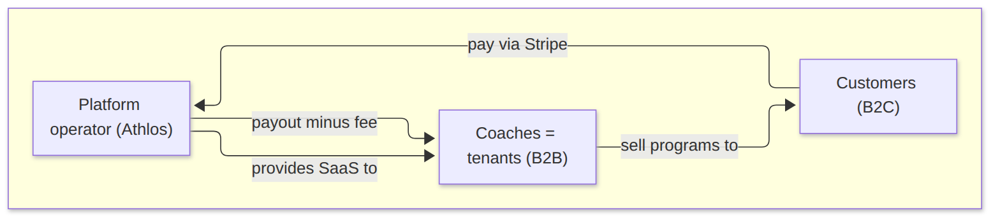
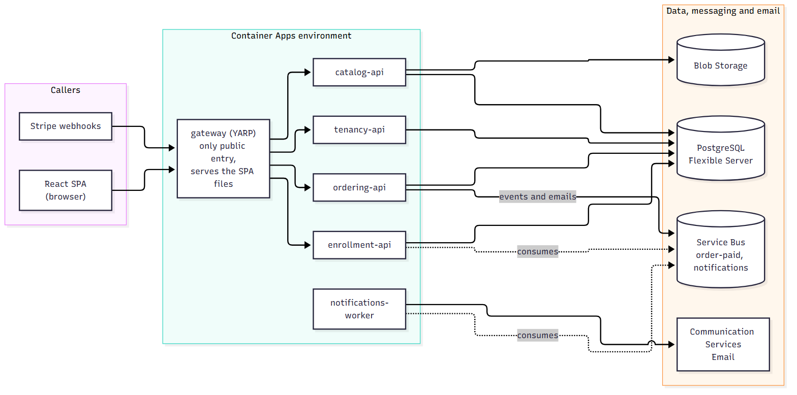
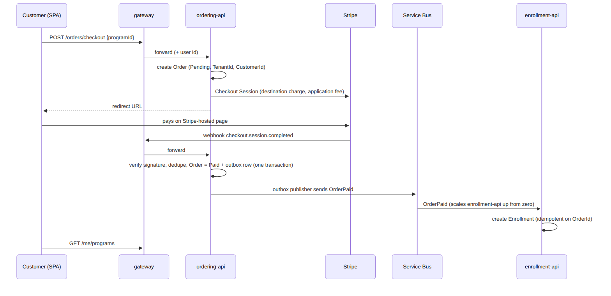
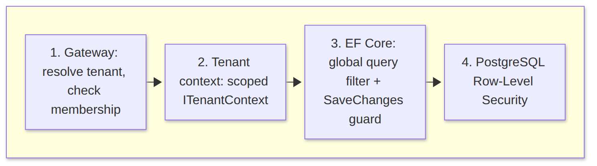
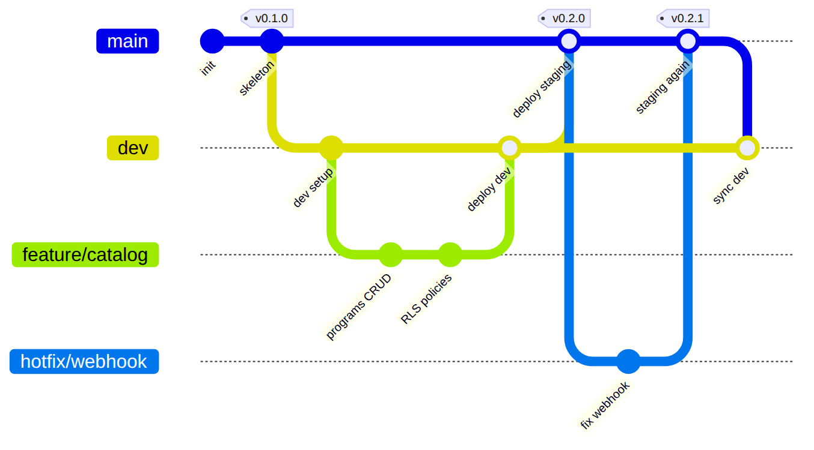

# Athlos: Architecture and Tooling Design

**Thesis:** Design and Implementation of a Multi-Tenant B2B2C Cloud-Native SaaS Platform
**Case study:** Athlos, a fitness marketplace. Coaches are tenants who open a workspace and sell programs. Customers browse and buy programs from any coach, like a big e-shop.
**Status:** v7, building (2026-09-27)

**Changes in v7:** services accept only gateway-signed requests, and each Container Apps environment runs in its own VNet. The first dev deploy showed that an app with *internal* ingress was reachable from the internet in an environment without a VNet, so network isolation alone could not carry layer 1 (§3.2, §11).

**Changes in v6:** region is **Italy North**, and the SPA is served by the gateway instead of Azure Static Web Apps. The University of Thessaly subscription only allows `italynorth`, `polandcentral`, `denmarkeast`, `belgiumcentral` and `switzerlandnorth`, and Static Web Apps is offered in none of them (§8.1, §10).

**Changes in v5:** user accounts (sign-up, email verification, password reset, profile, account deletion) and transactional email through a small notifications-worker and Azure Communication Services (§5.2, §5.3).

**Changes in v4:** added a **staging** environment. Branches stay `dev` and `main`; one build is promoted dev → staging → prod (§12). Bicep, cost, tests, CLAUDE.md and the branching and pipeline diagrams updated to match.

**Changes in v3:** added data model (§2.3), tenant lifecycle (§3.4), security checklist (§5.1), API conventions (§7.1), testing strategy, seed data and evaluation targets (§15.1 to §15.3), and a `CLAUDE.md` for the repo.

**Changes in v2:** renamed to Athlos; PostgreSQL instead of Azure SQL; dev and prod environments with a branching strategy and version tags (§12); diagrams exported as images so they read in any VS Code theme; cost re-checked (§10).

> **Diagrams** are PNG images in the `diagrams/` folder next to this file, so they look the same in any VS Code theme without extensions. Keep the folder beside this file when you move it into your repo (for example `docs/design.md` + `docs/diagrams/`). Each has a Mermaid source (`.mmd`) to edit; re-export with `npx @mermaid-js/mermaid-cli -i x.mmd -o x.png -b white -s 2`.

---

## 0. Decisions at a glance

| Area | Choice | Why |
|---|---|---|
| Backend | .NET 10 (LTS), ASP.NET Core Minimal APIs, EF Core 10 + Npgsql | Current LTS, Microsoft stack, minimal ceremony |
| Frontend | React 19 + TypeScript + Vite | Fast, standard, no framework lock-in |
| Local orchestration | Aspire (AppHost + ServiceDefaults) | One command runs everything, OpenTelemetry dashboard for free |
| Compute | **Azure Container Apps, Consumption plan** (decided) | Real containers and microservices, scales to zero, fits the budget. AKS trade-off in §9 |
| Container registry | Azure Container Registry, Standard | Azure for Students includes one Standard registry free for 12 months |
| API gateway | YARP (Microsoft, open source) as its own container app | Single entry point, tenant resolution, per-tenant rate limiting |
| Database | **Azure Database for PostgreSQL Flexible Server**, Burstable B1ms, PostgreSQL 17. One server, one database per service per environment | Azure for Students includes 750 h/month of B1ms + 32 GB storage free for 12 months. PostgreSQL has native Row-Level Security |
| Messaging | Azure Service Bus, Basic tier (queues) | About €0.04 per million operations. Standard tier costs €8.59/month |
| Identity | Microsoft Entra External ID | Free up to 50,000 monthly active users; sign-up, email verification and password reset built in |
| Email | Azure Communication Services Email, Azure-managed sender domain | Fractions of a cent per email; order and enrollment emails, staff invites |
| Payments | Stripe Connect (Express accounts) + Stripe Checkout, test mode | The B2B2C money flow: customer pays, coach gets paid, platform keeps a fee |
| Frontend hosting | Static files served by the gateway container | €0, same origin as the API (no CORS), headers set in code. Static Web Apps is not offered in the regions the subscription allows (§8.1) |
| Files (program media) | Azure Blob Storage | Pennies per month |
| Secrets | Azure Key Vault + managed identities | No connection strings or passwords in config |
| Observability | OpenTelemetry → Application Insights / Log Analytics | Vendor-neutral instrumentation, Azure backend |
| IaC | Bicep (hand-written small modules) | Native Azure, readable in a thesis |
| Region | Italy North (`italynorth`) | Closest allowed region to Greece; the subscription's policy allows only five regions (§10) |
| Environments | **dev, staging, prod** in Azure, plus local (Aspire) | Staging is a prod-like rehearsal of every release |
| CI/CD | GitHub Actions with OIDC to Azure; `dev` and `main` branches; SemVer release tags | No stored cloud secrets; build once, promote the same image dev → staging → prod |
| Tests | xUnit v3, Testcontainers, k6 for load | Real PostgreSQL in tests, tenant-isolation and noisy-neighbor experiments |
| Est. cost | **About €1 to €4 per month** while the Students free services apply | See §10 |

---

## 1. Domain and the B2B2C model



<sub>Source: [diagrams/01-b2b2c-model.mmd](diagrams/01-b2b2c-model.mmd)</sub>

Three actor types:

| Actor | Scope | Can do |
|---|---|---|
| **Platform admin** | Global | Manage tenants, plans, view platform metrics |
| **Coach** (tenant owner or staff) | One tenant | Configure workspace (name, slug, branding), create and publish programs, see own sales and own customers |
| **Customer** | Platform-wide identity | Browse all coaches, buy programs from many coaches, access purchased content, track progress |

**The B2B2C nuance worth a thesis section:** a customer is *not* inside a tenant. One customer account buys from many tenants. So data falls into three classes, and each gets its own scoping rule:

| Data class | Example | Scoping rule |
|---|---|---|
| Tenant-private | Draft programs, coach's sales report, workspace settings | Only members of that tenant |
| Tenant-owned, public | Published programs in the marketplace | Anyone can read; only the owning tenant can write |
| Customer-owned, cross-tenant | A customer's orders and enrollments | The customer sees all of their own; each coach sees only the rows for their tenant |

Core entities: `Tenant`, `Membership` (user ↔ tenant ↔ role), `Plan` (Free / Pro tier, drives quotas and rate limits), `Program`, `Workout` (program content), `Order`, `Enrollment`, `Progress`.

---

## 2. Architecture overview

Read it left to right: callers, the gateway and services, then the data stores they own.



<sub>Source: [diagrams/02-architecture-overview.mmd](diagrams/02-architecture-overview.mmd)</sub>

- Only the gateway has external ingress. All four APIs use **internal ingress** and the notifications-worker has no ingress at all, so the internet cannot reach them directly.
- The gateway also serves the SPA's static files (§8.1), so the browser talks to one origin.
- Not drawn, to keep the picture readable: the SPA signs users in with **Entra External ID**; ordering-api creates Checkout sessions on **Stripe**; every container app pulls its image from **Container Registry**, reads secrets from **Key Vault** with a managed identity, and sends OpenTelemetry data to **App Insights**; a **db-migrator** Container Apps Job applies migrations and RLS policies on each deploy.

### 2.1 Services

Four business services, a gateway and one small background worker for email. That is enough to show real microservice concerns (independent deploys, own data, async events) without bloat.

| Service | Owns | Key endpoints | Database |
|---|---|---|---|
| **gateway** | Routing, auth check, tenant resolution, per-tenant rate limits | All public traffic | none |
| **tenancy-api** | Tenants, memberships, plans, branding, Stripe connected-account id | Sign up as coach, workspace settings, Stripe onboarding link, internal membership lookup | `athlos_tenancy` |
| **catalog-api** | Programs, workouts, prices, publish state, media | Coach CRUD (tenant-scoped), public marketplace search (cross-tenant, published only) | `athlos_catalog` |
| **ordering-api** | Orders, Stripe Checkout sessions, Stripe webhooks, outbox | Create checkout, webhook receiver, customer "my orders", coach "my sales" | `athlos_ordering` |
| **enrollment-api** | Enrollments, progress | Customer "my programs", progress updates; consumes `OrderPaid` | `athlos_enrollment` |
| **notifications-worker** | Transactional email | No HTTP API; consumes the `notifications` queue and sends email through Azure Communication Services. Scales from zero on queue length | none |

Rules that keep it clean:
- **Database per service.** Each service has its own database and its own PostgreSQL login, which has no rights on the other databases.
- **Sync calls only where needed** (gateway → service, ordering → catalog for price lookup). Everything else is an event.
- **Vertical slices inside each service.** One folder per feature (`Features/Programs/CreateProgram.cs`), not layers of interfaces. No MediatR, no repositories on top of EF Core.

### 2.2 Main flow: buying a program



<sub>Source: [diagrams/03-checkout-flow.mmd](diagrams/03-checkout-flow.mmd)</sub>

### 2.3 Data model essentials

Enough for the first migrations. Every table has `id uuid` (UUIDv7 via `Guid.CreateVersion7()`, so inserts stay index-friendly), `created_at` and `updated_at`. **T** marks tenant-owned tables that carry `tenant_id` and an RLS policy.

| Service | Table | Key columns |
|---|---|---|
| tenancy | `tenants` | `slug` (unique), `display_name`, `status` (Active, Suspended, Deleted), `plan` (Free, Pro), `branding` (jsonb: logo URL, colors), `stripe_account_id`, `stripe_onboarding_complete` |
| tenancy | `memberships` **T** | `user_id` (Entra object id), `role` (Owner, Staff) |
| tenancy | `user_profiles` | `user_id` (unique), `email`, `display_name` |
| tenancy | `staff_invites` **T** | `email`, `token_hash`, `expires_at`, `accepted_at` |
| catalog | `programs` **T** | `title`, `slug`, `description`, `level`, `duration_weeks`, `price_amount` (integer cents), `currency`, `is_published`, `cover_image_path` |
| catalog | `workouts` **T** | `program_id`, `week`, `day`, `title`, `content` (Markdown), `video_url` |
| ordering | `orders` **T** | `customer_id`, `customer_email`, `program_id`, `program_title` (copy at purchase time), `amount`, `currency`, `platform_fee`, `status` (Pending, Paid, Failed, Refunded), `stripe_checkout_session_id` (unique) |
| ordering | `processed_stripe_events` | `stripe_event_id` (primary key, for webhook idempotency) |
| ordering | `outbox_messages` | `type`, `payload` (jsonb), `occurred_at`, `sent_at` |
| enrollment | `enrollments` **T** | `customer_id`, `program_id`, `order_id` (unique, for idempotency) |
| enrollment | `workout_progress` **T** | `enrollment_id`, `workout_id`, `completed_at` |

Workout videos are links to an external host (for example unlisted YouTube or Vimeo), not files in Blob Storage: streaming video from Azure would cost bandwidth and needs transcoding. Blob Storage holds images and small PDFs only.

Money is always integer minor units plus a currency code, never `decimal` floats in JSON. Services refer to each other's data by id only; ordering copies the title and price it needs at purchase time instead of joining across services.

---

## 3. Multi-tenancy design (the core of the thesis)

### 3.1 Isolation model

The thesis should describe the three standard models and justify the choice:

| Model | Description | Cost | Isolation |
|---|---|---|---|
| Silo | Database (or stack) per tenant | High | Strongest |
| Bridge | Schema per tenant, shared database | Medium | Medium |
| **Pool (chosen)** | Shared tables, `tenant_id` column on every tenant-owned row | Lowest | Enforced in code and in the database |

Pool is what a marketplace with many small coaches would use in practice, and it is the hardest to get right, which makes it the most interesting to implement. PostgreSQL makes the bridge model cheap to demo too (a schema per tenant), so "silo or bridge for a premium tier" is a good future-work section.

### 3.2 Defense in depth: four layers



<sub>Source: [diagrams/04-isolation-layers.mmd](diagrams/04-isolation-layers.mmd)</sub>

1. **Gateway: tenant resolution and membership.**
   - Tenant comes from the route for coach APIs: `/api/v1/studio/{tenantSlug}/...`. Public marketplace routes carry no tenant.
   - The gateway validates the JWT, maps slug → `TenantId` (cached with `HybridCache`), and checks the caller's membership and role via `tenancy-api` (cached about 60 s).
   - The gateway **strips** any incoming `X-Tenant-Id` / `X-User-Role` headers, then sets them itself.
   - The gateway **signs** every request it forwards: an HMAC-SHA256 over a timestamp, the method, path and query, and both trusted headers (`X-Gateway-Timestamp`, `X-Gateway-Signature`). Services reject anything without a valid signature younger than 60 s with `401`, except `/health/*` and `/version` (the platform's probes call those directly). The key is `gateway-signing-key` in each environment's Key Vault, read by the apps' managed identities; locally Aspire generates it.
   - **Why the signature and not only internal ingress:** the first deploy to dev showed that a Container Apps app with internal ingress, in an environment without a VNet, answered requests from the internet on its generated hostname. Each environment now runs in a VNet (§11) *and* services verify the signature, so a networking mistake alone no longer breaks tenant isolation. Every deploy smoke-tests this by calling tenancy-api directly and expecting anything but a 2xx.
   - Limits worth writing down: a captured signed request can be replayed for up to 60 s (all traffic is TLS, and capturing it means being inside the platform already), and the key is shared by the gateway and every service, so a compromised service could sign requests. Per-service keys or workload identity tokens (the gateway's managed identity requesting an Entra token per service) are the next step and good future work.
   - Services still validate the JWT themselves (audience and issuer). Belt and braces.
2. **Tenant context in each service.** A small shared library `Athlos.Tenancy` with a scoped `ITenantContext { TenantId?, UserId, Role }` populated by middleware. Endpoints never take `tenantId` from the request body.
3. **EF Core.**
   - Every tenant-owned entity implements `ITenantOwned { Guid TenantId }`.
   - A global query filter `e => e.TenantId == tenantContext.TenantId` is applied to all of them.
   - An override of `SaveChanges` sets `TenantId` on insert and throws if an update or delete targets another tenant's row.
   - `IgnoreQueryFilters()` is allowed only in explicitly named "cross-tenant" slices (public marketplace search, a customer's own orders) and is caught by a unit test that greps for it.
4. **PostgreSQL Row-Level Security.** The last line, which protects even against a bug in layer 3.
   - An EF Core interceptor sets the tenant for the current transaction with `SELECT set_config('app.tenant_id', @t, true)` (and `app.user_id`, `app.scope`). The `true` makes the setting **transaction-local**, so a pooled connection can never carry one tenant's context into another request.
   - A policy on each tenant table:

   ```sql
   ALTER TABLE programs ENABLE ROW LEVEL SECURITY;
   ALTER TABLE programs FORCE ROW LEVEL SECURITY;

   CREATE POLICY tenant_isolation ON programs
     USING (
       tenant_id = current_setting('app.tenant_id', true)::uuid
       OR (current_setting('app.scope', true) = 'public-read' AND is_published)
     )
     WITH CHECK (tenant_id = current_setting('app.tenant_id', true)::uuid);
   ```

   - For orders, the `USING` clause also allows `customer_id = current_setting('app.user_id', true)::uuid`, which is exactly the B2B2C rule from §1: the customer sees all of their own rows, the coach sees their tenant's rows.
   - **Two PostgreSQL pitfalls to handle and write about:** RLS does not apply to the table owner unless `FORCE ROW LEVEL SECURITY` is set, and it never applies to superusers or roles with `BYPASSRLS`. So the migrator role owns the tables, and each service connects as a separate, non-owner role with only `SELECT, INSERT, UPDATE, DELETE`.

**Other isolation points**
- **Blob storage:** paths are `tenants/{tenantId}/programs/{programId}/...`. The API issues short-lived, read-only user-delegation SAS URLs, and only for content the caller is enrolled in or owns.
- **Caches:** every cache key is prefixed with the tenant id.
- **Logs and traces:** `tenant.id` is on every span and log scope, so one tenant's activity can be isolated in queries (see §6).
- **Stripe:** each coach is a separate Connect account. Money never co-mingles in a way the platform has to reconcile by hand.

### 3.3 Proving isolation (evaluation chapter)

- An integration test suite (Testcontainers + real PostgreSQL 17) that, for **every** endpoint, calls with tenant B's identity against tenant A's resources and expects `404` (not `403`, which would leak existence).
- A database-level test that connects as the service role, sets `app.tenant_id` to tenant B, runs raw `SELECT *` on tenant A's rows, and expects zero rows. It also tries an `INSERT` with tenant A's id and expects a policy violation. This proves layer 4 alone holds.
- A test that turns layer 3 off (test-only flag) and shows layer 4 still blocks. Good material for the "defense in depth" argument.

### 3.4 Tenant lifecycle

| State | How it is entered | Effect |
|---|---|---|
| **Active** | Coach signs up | Workspace usable; programs can be published once Stripe onboarding is complete |
| **Suspended** | Platform admin action | Storefront and checkout return `404`; existing customers keep access to what they bought |
| **Deleted** | Owner or admin request | Tenant-private data is removed by `tenant_id` in every service (tenancy-api calls `DELETE /internal/tenants/{id}` on each service; Service Bus Basic has no topics for a broadcast), blobs under `tenants/{id}/` are deleted; orders are kept for accounting with the tenant marked deleted |

Deleting one tenant's data with one key is a strong, demonstrable argument for the pool model's `tenant_id` discipline, and it is the GDPR "right to erasure" angle for the thesis. Plans (Free, Pro) are assigned by the platform admin; charging coaches a subscription through Stripe Billing is future work.

---

## 4. Noisy-neighbor protection

Goal: one tenant's spike must not degrade others. Layered, cheapest first:

| # | Mechanism | Where | Implementation |
|---|---|---|---|
| 1 | Per-tenant rate limiting | gateway | `System.Threading.RateLimiting` `PartitionedRateLimiter` keyed by `TenantId` (token bucket), limits come from the tenant's plan (Free: e.g. 20 req/s, Pro: 100 req/s). Returns `429` with `Retry-After` |
| 2 | Per-tenant concurrency limit on expensive endpoints | gateway | Concurrency limiter partitioned by tenant for search and upload routes |
| 3 | Quotas | tenancy-api + services | Max programs, max media GB, max staff by plan. Checked on write |
| 4 | Elastic scale | Container Apps | HTTP scale rule (concurrent requests) on each app, and Service Bus queue-length rules on enrollment-api and notifications-worker. Each app has `maxReplicas` set, which also caps the bill |
| 5 | Async offloading | Service Bus | Slow work (enrollment, future emails) runs off the request path |
| 6 | Resilience between services | all | `Microsoft.Extensions.Http.Resilience` standard handler: timeouts, retries with jitter, circuit breaker |
| 7 | Database protection | all | Indexes leading with `tenant_id`, `statement_timeout` per service role, a small connection pool per service (B1ms allows about 50 connections in total), hard page-size caps (max 50) |

**Known limitation (write it down):** the gateway's rate limiter is in memory, so with N gateway replicas each tenant effectively gets N × the limit. The fixes are a distributed limiter on Redis (about €13+/month, over budget) or dividing the limit by the replica count. For the thesis, keep the gateway at `maxReplicas: 2` and document the trade-off.

**Experiment for the evaluation chapter** (k6, open source, run from your machine or a GitHub Actions job, against the **staging** environment, so results are not disturbed by work in progress on dev):
1. Tenant B sends a steady 10 req/s; measure its p95 latency (baseline).
2. Tenant A floods at 300 req/s. Run once with limits off and once with limits on.
3. Report tenant B's p95 and error rate in both runs, and tenant A's 429 rate. Graph it from App Insights.

The shared B1ms database is itself a noisy-neighbor story: without limits, tenant A's flood exhausts connections and CPU credits for everyone. That makes the "limits on" result more convincing.

---

## 5. Identity and authorization

- **Microsoft Entra External ID** (the successor of Azure AD B2C) for sign-up and sign-in. Free for the first 50,000 monthly active users. Customers and coaches use the same user flow (email + password, optionally Google). One external tenant, with a separate app registration per environment (dev, staging, prod).
- The SPA uses **MSAL React** (auth code + PKCE). The gateway and services validate tokens with `Microsoft.Identity.Web`.
- **Authorization data lives in your app, not in the token.** "Who is a coach of which tenant" is in `tenancy-api` `memberships`. This keeps tokens small, avoids a custom-claims extension, and makes role changes immediate. One Entra app role, `Platform.Admin`, covers the admin.
- Becoming a coach: a signed-in user calls `POST /api/v1/tenants` → a tenant is created with them as `Owner` → they are sent to Stripe Connect onboarding.

### 5.1 Security checklist

- HTTPS only; HSTS and basic security headers (`X-Content-Type-Options`, `Referrer-Policy`, a Content Security Policy on the SPA, all set by the gateway, which serves the SPA).
- No CORS: the SPA and the API share the gateway's origin. Local development uses the Vite dev-server proxy, so CORS stays off there too.
- Stripe webhooks: verify the `Stripe-Signature` header with the signing secret, reject events older than 5 minutes, dedupe on event id.
- No secrets in the repo, ever. Local secrets live in .NET user secrets or in Aspire parameters; Azure secrets in Key Vault. Enable GitHub secret scanning and push protection.
- Upload limits: content-type allow-list and size cap for media; SAS URLs expire within 15 minutes.
- Personal data is minimal: Entra holds credentials; Athlos stores user ids, display names and emails only where needed.
- The API never returns stack traces; `ProblemDetails` only, with the trace id so errors can be found in App Insights.

### 5.2 User accounts

Entra External ID does the account work, so Athlos never stores or handles passwords.

| Need | How it works | Built by |
|---|---|---|
| Sign-up | "Email with password" user flow; the email address is the sign-in name (no separate username). Optional Google sign-in | Entra, configured in the portal |
| Email verification | Entra sends a one-time code to the address during sign-up | Entra |
| Forgot password | Self-service password reset: a one-time code by email, then a new password. Enable Email OTP and the "Forgot password?" link in Company Branding | Entra |
| Password change, MFA | Entra user flow settings; MFA by email code can be switched on per user flow | Entra |
| Sign-in page look | Company Branding (logo, colors) for Athlos as a whole | Entra |
| Display name and profile | Entra collects the display name at sign-up. Athlos keeps a small `user_profiles` table in tenancy-api (`user_id`, `email`, `display_name`, `created_at`), created on first sign-in | Athlos |
| Account deletion | `DELETE /api/v1/me`: Athlos removes or anonymizes the user's data in each service, then deletes the Entra user through Microsoft Graph | Athlos |
| Coach staff invites | Owner enters an email; tenancy-api stores an invite token (valid 7 days) and queues an invite email; the invitee signs in and accepts | Athlos |

Things to know and write down in the thesis:
- Entra's own emails (verification and reset codes) come from a Microsoft sender with Athlos branding. Sending them from your own domain needs a custom email provider extension; that is out of scope.
- Branding of the sign-in pages is per platform, not per coach. Per-tenant branding lives in the Athlos app itself (the storefront).
- Changing the sign-in email address is not offered in v1; the user can create a new account.

### 5.3 Transactional email

Emails Athlos itself sends, all through the `notifications` queue:

| Trigger | Recipient | Email | Queued by |
|---|---|---|---|
| Order paid | Customer | Purchase confirmation and link to the program | enrollment-api, after it creates the enrollment |
| Order paid | Coach (tenant owners) | "You made a sale" | ordering-api |
| Staff invite | Invitee | Invite link | tenancy-api |
| Stripe onboarding incomplete after 3 days (optional) | Coach | Reminder | tenancy-api |

- **Service:** Azure Communication Services Email with an **Azure-managed domain** (`...azurecomm.net` sender, no DNS setup). A custom domain can be added later if you own one. Stripe also emails its own receipts to customers in live mode; test mode does not.
- **Message:** `{ type, to, locale, templateData }`. The worker renders HTML and plain-text templates kept in the repo (Razor or simple Liquid-style templates) and calls the ACS SDK with its managed identity.
- **Delivery guarantee:** at least once. A rare duplicate email is accepted and documented; the worker keeps no database. Failed sends retry through Service Bus and end in the dead-letter queue, which the 5xx alert also watches.
- **Local development:** the worker writes emails to the console and to a local folder instead of sending them, so no real email leaves your machine; dev and staging can use the same "sink" mode.
- **Privacy:** email addresses are passed in the message only; they are not logged, and the `to` field is redacted in traces.

---

## 6. Observability

- **Instrumentation:** OpenTelemetry everywhere, set up once in the Aspire `ServiceDefaults` project (traces, metrics, logs; ASP.NET Core, HttpClient, EF Core/Npgsql, Service Bus).
- **Local:** the Aspire dashboard shows traces, logs and metrics with zero setup.
- **Azure:** the Azure Monitor OpenTelemetry Distro (`Azure.Monitor.OpenTelemetry.AspNetCore`) exports to one workspace-based Application Insights per environment, both backed by one shared Log Analytics workspace. It switches on when `APPLICATIONINSIGHTS_CONNECTION_STRING` is present.
- **Tenant-aware telemetry:** middleware adds `tenant.id`, `tenant.plan`, `user.role` and `service.version` (the release tag) to the current `Activity` and log scope. Custom metrics: `athlos.ratelimit.rejected{tenant}`, `athlos.orders.paid{tenant}`.
- **Dashboards:** one Azure Workbook (declared in Bicep) with per-tenant request rate, p95 latency, error rate, 429s, and a distributed trace link. Filtering by `service.version` shows the effect of each release.
- **Alerts:** two, both cheap: 5xx rate over threshold on the prod gateway, and the monthly budget (§10).
- **Cost guard:** Log Analytics daily cap of 0.15 GB (the first 5 GB/month are free, then €2.57/GB). Turn off Container Apps console-log forwarding if OpenTelemetry logs already cover it, so logs are not ingested twice.

---

## 7. Repository and code layout

One GitHub monorepo, `athlos`. Microservices do not require many repos, and one repo keeps CI, IaC and the thesis in sync.

```
athlos/
├─ .github/
│  ├─ workflows/ ci.yml, deploy-dev.yml, deploy-staging.yml, release-prod.yml
│  ├─ pull_request_template.md
│  └─ dependabot.yml
├─ infra/
│  ├─ shared.bicep             # registry, PostgreSQL server, Log Analytics
│  ├─ env.bicep                # one environment (dev, staging or prod)
│  ├─ dev.bicepparam
│  ├─ staging.bicepparam
│  ├─ prod.bicepparam
│  └─ modules/ monitoring.bicep, registry.bicep, keyvault.bicep, postgres.bicep,
│              servicebus.bicep, storage.bicep, email.bicep, aca-env.bicep, container-app.bicep,
│              identity.bicep, budget.bicep
├─ src/
│  ├─ AppHost/                 # Aspire orchestration (local only)
│  ├─ ServiceDefaults/         # OpenTelemetry, health, resilience, service discovery
│  ├─ BuildingBlocks/
│  │  ├─ Athlos.Tenancy/       # ITenantContext, middleware, EF filters, RLS interceptor
│  │  └─ Athlos.Messaging/     # outbox + thin Service Bus publisher/consumer
│  ├─ Gateway/
│  ├─ Services/
│  │  ├─ Athlos.Tenancy.Api/
│  │  ├─ Athlos.Catalog.Api/
│  │  ├─ Athlos.Ordering.Api/
│  │  └─ Athlos.Enrollment.Api/
│  ├─ Workers/Athlos.Notifications.Worker/  # email sender, templates
│  ├─ Tools/Athlos.DbMigrator/ # EF migrations + roles + RLS policies, deployed as ACA Job
│  └─ web/                     # React SPA (Vite)
├─ tests/
│  ├─ *.UnitTests/
│  ├─ *.IntegrationTests/      # Testcontainers
│  ├─ Athlos.IsolationTests/   # cross-tenant suite from §3.3
│  └─ load/                    # k6 scripts
├─ docs/                       # this design (design.md), diagrams/, adr/
├─ CLAUDE.md                   # instructions for Claude Code
├─ Directory.Build.props       # nullable, warnings as errors, analyzers
├─ Directory.Packages.props    # central package management
├─ global.json                 # pin .NET 10 SDK
└─ Athlos.slnx
```

**Naming conventions**

| Thing | Convention | Example |
|---|---|---|
| Azure resources | `{abbreviation}-athlos-{env}` (Cloud Adoption Framework abbreviations) | `ca-athlos-gateway-prod`, `cae-athlos-dev`, `kv-athlos-prod` |
| Shared Azure resources | `{abbreviation}-athlos-shared` | `psql-athlos-shared`, `log-athlos-shared` |
| Names that forbid dashes | no separators | `acrathlosshared`, `stathlosprod` |
| Resource groups | `rg-athlos-{shared,dev,staging,prod}` | `rg-athlos-staging` |
| .NET namespaces and projects | `Athlos.{Area}` | `Athlos.Catalog.Api` |
| Container images | `athlos/{service}` | `acrathlosshared.azurecr.io/athlos/catalog-api:v1.2.0` |
| PostgreSQL databases | `athlos_{service}_{env}` | `athlos_catalog_prod` |
| PostgreSQL roles | `athlos_{service}_{env}_app` (service), `athlos_migrator` (owner) | `athlos_catalog_prod_app` |
| Service Bus queues | kebab-case event or purpose name | `order-paid`, `notifications` |

**Code conventions:** nullable on, warnings (including analyzer warnings) as errors, EF Core with `UseSnakeCaseNamingConvention()` so tables and columns are idiomatic PostgreSQL, built-in `Microsoft.AspNetCore.OpenApi` for OpenAPI docs, Scalar for the API explorer UI, `ProblemDetails` for errors, built-in minimal API validation for input. Short ADRs (Architecture Decision Records) in `docs/adr/` double as thesis material.

**Containers without Dockerfiles:** use the .NET SDK's built-in container publishing (`dotnet publish /t:PublishContainer`), which produces small, non-root, chiseled Ubuntu images. The React app has no container of its own: its Vite build is copied into the gateway's `wwwroot` when the gateway image is published (§8.1).

### 7.1 API conventions

| Concern | Convention |
|---|---|
| Routes | Public: `/api/v1/marketplace/...`; coach: `/api/v1/studio/{tenantSlug}/...`; customer: `/api/v1/me/...`; webhooks: `/webhooks/stripe`; service-to-service: `/internal/...` (never routed by the gateway) |
| Versioning | URL segment `v1`; a breaking change adds `v2` next to it |
| JSON | camelCase, ISO 8601 UTC timestamps, enums as strings |
| Paging | `?page=1&pageSize=20`, max 50, response `{ items, page, pageSize, totalCount }` |
| Errors | RFC 9457 `ProblemDetails`, with `traceId`; validation errors list the failing fields |
| Not found vs forbidden | Another tenant's resource is always `404` |
| Idempotency | `POST /orders/checkout` accepts an `Idempotency-Key` header; webhooks and queue consumers dedupe on ids |
| Health | `/health/live` and `/health/ready` (ready checks the database), wired to Container Apps liveness and readiness probes |
| Version | `GET /version` returns the release tag |

---

## 8. Frontend

| Concern | Choice |
|---|---|
| Build | Vite + React 19 + TypeScript (strict) |
| Routing | React Router |
| Server state | TanStack Query |
| Auth | MSAL React |
| UI | Tailwind CSS + shadcn/ui (copy-in components, no heavy UI framework) |
| API client | `openapi-typescript` + `openapi-fetch`, generated from the services' OpenAPI docs, so the client is typed end to end |
| Tests | Vitest + Testing Library; Playwright for 2–3 end-to-end happy paths (optional) |

One SPA with four areas:
- `/` marketplace: browse and search all coaches' published programs.
- `/c/{slug}` coach storefront: the tenant's branded page (logo, colors from workspace settings). This is the visible "configure your dedicated workspace" part of the thesis.
- `/studio/{slug}` coach dashboard: programs, sales, settings, Stripe onboarding.
- `/me` customer area: purchased programs and progress.

The footer shows the running version (from the gateway's `/version` endpoint), which makes releases visible in demos.

### 8.1 Hosting: served by the gateway

The Vite build is part of the gateway image. The gateway serves it with ASP.NET Core static files (`MapStaticAssets`, which adds compression and fingerprinted caching), falls back to `index.html` for client-side routes, and sends the security headers from §5.1. API routes (`/api/...`, `/webhooks/...`, `/health/...`, `/version`) are matched first, so the fallback never hides an API 404.

**Build once, promote still holds.** Anything that differs per environment (Entra client id and authority, API scopes) is not baked into the bundle. The gateway serves it at `GET /config.json` from its own environment variables, and the SPA fetches it before rendering. The same image runs in dev, staging and prod.

**Why not Static Web Apps:** it is offered only in a few regions (West US 2, Central US, East US 2, West Europe, East Asia), and the student subscription's policy allows none of them. Blob Storage static websites were the other option, but they cannot set response headers (no CSP) and answer client-side routes with a 404 status. Serving from the gateway costs nothing extra, removes CORS entirely, and is one less resource per environment. The trade-off: the SPA has no global CDN, and a gateway cold start also delays the first page load. Both are acceptable for the thesis and are named as future work (Front Door or a CDN in front of the gateway).

---

## 9. Compute: Container Apps vs AKS

**Decided: Container Apps.** Kept here because the thesis should justify it.

| | Azure Container Apps (Consumption) | AKS |
|---|---|---|
| Monthly cost here | ~€0–2 (inside free grants, scale to zero) | ~€35–45 minimum: control plane is free on the Free tier, but you pay for at least one always-on node VM, its disk, and a Standard load balancer with public IP (estimate, verify in the Azure pricing calculator) |
| Budget impact | Fits 12 months, with dev, staging and prod | Burns €100 in about 2.5 months |
| Shows microservices + containers | Yes | Yes |
| Shows Kubernetes skills | Indirectly: ACA runs on Kubernetes with KEDA and Envoy, and you configure KEDA scale rules directly | Directly: manifests, Helm, ingress controller, HPA/KEDA |
| Ops burden | Very low | Node pools, upgrades, ingress, cert management |
| Noisy-neighbor story | Scale rules, replica caps | Plus namespaces, ResourceQuotas, LimitRanges per tenant tier |

In the thesis, explain that ACA is a managed abstraction over Kubernetes + KEDA, and discuss what AKS would add (namespace-per-tenant-tier, ResourceQuotas) as the path for scale.

---

## 10. Azure cost estimate

Azure for Students gives $100 of credit for 12 months **and** a set of free services for 12 months. Two of those free services change the picture (from the Azure for Students page, checked 2026-09-26):
- **Azure Database for PostgreSQL Flexible Server:** 750 hours/month of Burstable B1ms, 32 GB storage, 32 GB backup storage.
- **Azure Container Registry:** one Standard registry with 100 GB storage.

Other prices are from the Azure Retail Prices API, West Europe, EUR (Italy North prices are within a few percent), pay-as-you-go, checked the same day.

| Resource | SKU / setting | €/month |
|---|---|---|
| PostgreSQL Flexible Server | 1 × B1ms, 32 GB storage, 7-day backups, HA off, geo-backup off, storage auto-grow **off**. Holds all 12 databases (4 services × dev, staging, prod) | **0** (free service) |
| Container Registry | Standard, shared by all environments | **0** (free service) |
| Container Apps | Three Consumption environments (dev, staging, prod), 6 apps each, `minReplicas: 0`. Free grant per subscription per month: 180,000 vCPU-s, 360,000 GiB-s, 2M requests | 0–2 |
| Container Apps Jobs | db-migrator, runs for seconds per deploy | ~0 |
| Service Bus | Basic, one namespace per environment, €0.0429 per million operations | ~0.01 |
| Storage accounts | Blob, LRS, a few GB, one per environment | <0.50 |
| Key Vault | Standard, one per environment | <0.10 |
| Log Analytics + App Insights | One shared workspace, first 5 GB/month free, daily cap 0.15 GB | 0–1 |
| Entra External ID | Under 50,000 MAU; sign-up and password-reset emails included | 0 |
| Communication Services Email | Azure-managed domain, a few hundred emails a month | ~0 |
| Stripe | Test mode | 0 |
| **Total** | | **≈ €1–4** |

That leaves most of the €100 unused, which is a comfortable buffer for load tests and mistakes.

**Rules that keep it at that number:**
- **Exactly one PostgreSQL server.** 750 free hours cover one B1ms running all month (730 h). A second server (for example a separate dev server) would be billed. That is why dev, staging and prod share the server with separate databases and roles.
- **Small connection pools.** B1ms allows about 50 connections. With 4 services in 3 environments, cap each service at `Maximum Pool Size=3` in its connection string (36 in total, leaving room for the migrator and your own tools).
- Keep storage at 32 GB and auto-grow off, or the extra GB are billed.
- Registry must be the **Standard** SKU to match the free service; Basic is not the free one.
- **Budget in Bicep** (`Microsoft.Consumption/budgets`): alert at €5/month actual and at 80% forecast.
- Everything scales to zero. Set `minReplicas: 1` on the prod gateway only during demos. An always-on gateway at 0.25 vCPU / 0.5 GiB costs about €5/month on its own.
- `maxReplicas` on every app (gateway 2, others 3).

**If the free services do not apply** (check once in the portal under *Free services*, where the B1ms hours and the registry should be listed): B1ms plus 32 GB storage would cost roughly €15/month and ACR Standard €17/month (€0.5724/day). That would break the budget, and the fallback would be one database server for prod only (dev runs locally with Aspire) plus GitHub Container Registry. The B1ms figure is an estimate; the price sheet did not return it today.

**Also check once:**
- Azure for Students subscriptions often restrict regions by policy. **Checked 2026-09-27:** this subscription allows only `italynorth`, `polandcentral`, `denmarkeast`, `belgiumcentral` and `switzerlandnorth`. Athlos uses **Italy North** for everything; B1ms, PostgreSQL 17, Container Apps, Service Bus, ACR, Key Vault and Log Analytics are all available there.
- Free services end after 12 months, together with the credit. Plan the thesis evaluation inside that window.

---

## 11. Infrastructure as Code (Bicep)

- **Four resource groups:** `rg-athlos-shared` (registry, PostgreSQL server, Log Analytics), and `rg-athlos-dev`, `rg-athlos-staging`, `rg-athlos-prod` (everything else, one copy per environment). `shared.bicep` deploys the first; `env.bicep` with `dev.bicepparam`, `staging.bicepparam` or `prod.bicepparam` deploys the other three from the same code, which is the IaC point the thesis should make.
- The resource groups and the GitHub OIDC app registration are created once by hand (or a tiny bootstrap script), documented in `infra/README.md`.
- **Hand-written, small modules** instead of Azure Verified Modules. AVM is good, but for a thesis readable 40-line modules explain more than a 500-parameter one.
- **Identity model:**
  - One user-assigned managed identity per service per environment (they are free).
  - Role assignments in Bicep: `AcrPull` on the registry, `Key Vault Secrets User`, `Azure Service Bus Data Sender` (ordering) and `Data Receiver` (enrollment), `Storage Blob Data Contributor` (catalog), and a role on the Communication Services resource for the notifications-worker so it sends email with its managed identity.
  - PostgreSQL uses **Microsoft Entra authentication** (password auth disabled). The db-migrator identity is an Entra admin on the server; on deploy it creates the databases, maps each service's managed identity to its own PostgreSQL role (`pgaadauth_create_principal`), grants that role DML rights on its own database only, and applies the RLS policies.
- **PostgreSQL server settings in Bicep:** `sku: { name: 'Standard_B1ms', tier: 'Burstable' }`, `version: '17'`, `storage: { storageSizeGB: 32, autoGrow: 'Disabled' }`, `backup: { backupRetentionDays: 7, geoRedundantBackup: 'Disabled' }`, `highAvailability: { mode: 'Disabled' }`, `authConfig: { activeDirectoryAuth: 'Enabled', passwordAuth: 'Disabled' }`.
- **Networking:** each Container Apps environment runs in its own VNet (`vnet-athlos-{env}`, a delegated subnet, Consumption workload profile only). VNets and VNet-integrated Consumption environments cost nothing. The environment stays public (`internal: false`) so the gateway can have external ingress. PostgreSQL keeps public access with Entra-only auth and the "Allow public access from Azure services" firewall rule, ACR admin user is disabled, HTTPS only. Private endpoints (which do cost) remain a production hardening step for the thesis.
- **Secrets:** only the Stripe secret key and webhook signing secret are real secrets, one pair per environment. They go into that environment's Key Vault once, and container apps reference them as Key Vault secret references.
- **PR check:** `az deployment group what-if` on every PR touching `infra/`, output posted to the job summary.

---

## 12. Branching, versioning and CI/CD

### 12.1 Branches

| Branch | Purpose | Deploys to | Protection |
|---|---|---|---|
| `main` | Release line. Every merge is a release candidate | **staging** on every merge; **prod** on a version tag | PR required (only from `dev` or `hotfix/*`), CI must pass, no direct pushes |
| `dev` | Integration. Everything merged here is deployed | **dev**, on every push | PR required, CI must pass |
| `feature/<short-name>` | One piece of work, branched from `dev` | nothing (CI only) | none |
| `hotfix/<short-name>` | Urgent prod fix, branched from `main` | staging, then prod after release | merged into `main`, then `main` merged back into `dev` |

**Environments are not branches.** There is no `staging` branch: staging is where `main` runs before it is released. Promoting one build through environments avoids the merge drift that a branch per environment causes.

| Environment | Deploys | Purpose | Data |
|---|---|---|---|
| local | `aspire run` | Day-to-day development | Containers, seed data |
| dev | every push to `dev` | Integration, quick feedback, may be broken | Seed data, reset freely |
| staging | every merge into `main` | Prod-like rehearsal: smoke tests, end-to-end tests, load tests | Seed data |
| prod | a `v*` release tag, after your approval | What the thesis demo and evaluation run on | Real demo data |



<sub>Source: [diagrams/05-branching.mmd](diagrams/05-branching.mmd)</sub>

Each merge into `main` deploys to staging; the version tag is added once staging checks pass, and that tag deploys to prod.

Merge style: squash-merge feature branches into `dev` (one clean commit per feature), and a merge commit from `dev` into `main` so release history is easy to follow. The merge commit is also how staging finds dev's images: its second parent is the dev commit they were built from. A squash into `main` would make staging rebuild.

**Commit messages:** Conventional Commits (`feat:`, `fix:`, `chore:`, `docs:`), so release notes can be generated and the next version number is obvious.

### 12.2 Versions and tags

- **Semantic Versioning** for the whole platform: `vMAJOR.MINOR.PATCH`, starting at `v0.1.0`; `v1.0.0` is the version you evaluate in the thesis.
- A release is a **GitHub Release** created on `main` once staging looks good, for example `gh release create v0.3.0 --target main --generate-notes`. The tag triggers the prod deployment.
- **Build once, promote.** Images are built on `dev` and tagged with the commit SHA (`sha-3f2a1c9`). Staging deploys those same images. A release does not rebuild either: it adds the version tag to the exact images staging is running (`az acr import` within the same registry), then deploys that tag to prod. What you tested is byte-for-byte what you ship.
- The version is passed to each container app as the `APP_VERSION` environment variable and reported as the OpenTelemetry `service.version`, on `/version`, and in the SPA footer.
- **Rollback** is redeploying the previous tag: run the release workflow manually with `v0.2.0`.

### 12.3 Workflows

Authentication to Azure is **OIDC federated credentials** (`azure/login` with `client-id`, `tenant-id`, `subscription-id`), one federated credential per GitHub Environment, so no Azure secret is stored in GitHub.

| Workflow | Trigger | Steps |
|---|---|---|
| `ci.yml` | PR to `dev` or `main` | `dotnet build` + `dotnet test` (unit, integration, isolation; Testcontainers on the hosted runner); frontend lint, type-check, `vitest`, `vite build`; `az bicep lint` + `what-if` when `infra/**` changed |
| `deploy-dev.yml` | push to `dev` | build and test → publish images tagged `sha-<short>` to the registry → Bicep deploy `env.bicep` with `dev.bicepparam` → run db-migrator job → smoke test `/health` and the SPA (the SPA ships inside the gateway image) |
| `deploy-staging.yml` | push to `main` | find the images for the merged `dev` commit (the merge commit's second parent) and add the tag `sha-<main commit>` to them with `az acr import`; for a hotfix, build them → Bicep deploy with `staging.bicepparam` → run db-migrator job → smoke test → Playwright end-to-end tests |
| `release-prod.yml` | tag `v*` pushed (from a GitHub Release), or manual with a tag input for rollback | take the images tagged `sha-<tagged commit>` (the ones staging deployed) → add the version tag → **wait for approval** → Bicep deploy with `prod.bicepparam` → run db-migrator job → smoke test |


<sub>Source: [diagrams/06-release-pipeline.mmd](diagrams/06-release-pipeline.mmd)</sub>

**GitHub Environments:** `dev` (no restrictions), `staging` (deployments only from `main`) and `prod` (deployments only from `v*` tags). Branch policies on a private repo need GitHub Pro (in the Student Developer Pack). **Required reviewers do not**: on private repos they need GitHub Enterprise (checked 2026-09-27). The approval step for prod is therefore publishing the GitHub Release itself, which only the repo owner can do; if the repo is made public, required reviewers become free and can be added to `prod`.

**OIDC subject:** GitHub's token names the owner and repo with their immutable ids (`repo:akazopidis@70575515/athlos@1390631916:environment:prod`), so a renamed or re-created repo cannot reuse the federated credentials. `bootstrap.sh` builds the subject from the ids.

**Supply chain and hygiene:**
- **Dependabot** for NuGet, npm, GitHub Actions and base images, targeting `dev`.
- **CodeQL** is free on public repositories. If you make the repo public (it is meant to be a reference guide), turn it on.
- Pin third-party actions to a commit SHA.

---

## 13. Local development

```
aspire run          # or: dotnet run --project src/AppHost
```

The Aspire AppHost starts:
- the gateway and the four APIs,
- **PostgreSQL 17** in a container (one server, four databases), plus pgAdmin or pgweb if you want a UI,
- the **Service Bus emulator** container,
- **Azurite** (Blob Storage emulator),
- the Vite dev server for the SPA,
- the Aspire dashboard (logs, traces, metrics).

Plus, in a second terminal, `stripe listen --forward-to https://localhost:<gateway>/webhooks/stripe` to receive Stripe test webhooks.

Tools to install: .NET 10 SDK, Node 22 LTS, Docker Desktop (or Podman), Azure CLI with Bicep, Aspire CLI, GitHub CLI, Stripe CLI, k6, VS Code with the C# Dev Kit, Bicep, Azure Container Apps and PostgreSQL extensions.

---

## 14. What is deliberately left out

To keep it modern without bloat, these are named in the thesis as options, not built:

| Left out | Why |
|---|---|
| AKS | Cost; see §9 |
| Azure API Management | YARP covers routing and rate limits in code you control |
| Redis | €13+/month; `HybridCache` in memory is enough at this scale |
| Dapr | Adds a runtime to learn; direct SDKs are simpler to explain |
| MassTransit / NServiceBus | Commercial licensing on recent versions; a 100-line outbox + SDK is enough |
| Service Bus Standard (topics) | €8.59/month. One queue with one consumer is all the flow needs |
| Cosmos DB, event sourcing, CQRS | Not needed for the problem |
| Front Door, WAF, private endpoints | Production hardening, discussed but not built (VNets themselves are built, §11) |
| A second PostgreSQL server | Only one B1ms is free; all environments share it with separate databases and roles |
| A branch per environment | Environments are promoted by tags, not by merging between branches (§12.1) |
| Video hosting and streaming | Bandwidth and transcoding cost; workouts link to an external video host |
| Terraform | Bicep matches the Microsoft-first choice |
| Static Web Apps | Not offered in the regions the subscription allows; the gateway serves the SPA (§8.1) |

---

## 15. Build plan

Build a deployable "walking skeleton" first, so IaC and CI/CD grow with the code instead of being bolted on at the end.

| Phase | Outcome |
|---|---|
| 0. Setup | Repo with `main` and `dev`, branch protection, `global.json`, solution, Aspire AppHost + ServiceDefaults, resource groups, OIDC app registration, GitHub Environments (dev, staging, prod), budget alert |
| 1. Walking skeleton | Gateway + one hello-world service deployed to dev, promoted to staging, then released to prod as `v0.1.0`; traces visible in App Insights |
| 2. Identity + tenancy | Entra External ID, tenancy-api, coach sign-up, membership lookup in gateway, `Athlos.Tenancy` library |
| 3. Catalog | Programs CRUD, publish, marketplace search, blob media, RLS policies, isolation tests |
| 4. Ordering + Stripe | Connect onboarding, Checkout, webhooks, outbox |
| 5. Enrollment + email | Service Bus consumer, KEDA queue scaling, customer "my programs" and progress; notifications-worker with purchase, sale and invite emails |
| 6. Frontend | Marketplace, storefront branding, studio, customer area |
| 7. Noisy neighbor | Plan-based rate limits and quotas, k6 experiment on staging |
| 8. Observability polish | Tenant-aware workbook, alerts |
| 9. Evaluation | Release `v1.0.0`; isolation test results, noisy-neighbor graphs, cost report from Cost Management, write-up |

### 15.1 Testing strategy

| Level | Tool | What | Runs in |
|---|---|---|---|
| Unit | xUnit v3 | Domain rules, rate-limit partitioning, price and fee calculation | every PR |
| Integration | xUnit v3 + Testcontainers (PostgreSQL 17) + `WebApplicationFactory` | Each endpoint against a real database, including migrations and RLS | every PR |
| Isolation | same | The cross-tenant suite from §3.3; **a failing isolation test blocks the merge** | every PR |
| Contract | OpenAPI documents checked into the repo | CI fails if an endpoint's OpenAPI changes without the file being updated, so the SPA client never drifts | every PR |
| Frontend | Vitest + Testing Library | Components with API calls mocked | every PR |
| End-to-end | Playwright (optional) | Sign in, buy a program with a Stripe test card, see it in "my programs" | on every staging deploy |
| Load | k6 | Noisy-neighbor experiment (§4) | on demand against staging |

Stripe in tests: unit and integration tests use a fake `IPaymentGateway`; the real Stripe test mode is exercised only end to end.

### 15.2 Seed data

A `--seed` mode in the db-migrator (dev and staging only) creates 3 demo coaches on different plans, about 20 programs, and 2 customers with purchases. The k6 scripts and demos use these fixed tenants, so results are repeatable.

### 15.3 Targets for the evaluation chapter

Measurable targets make the evaluation honest. Suggested starting values, measured on prod with the demo data:

| Target | Value |
|---|---|
| Cross-tenant data leaks in the isolation suite | 0 |
| Gateway p95 latency, warm, normal load | < 300 ms |
| Tenant B p95 during tenant A's flood, limits on | within 20% of baseline |
| Time from `git push` on `dev` to running in dev | < 15 min |
| Time from release tag to running in prod (after approval) | < 10 min, no rebuild |
| Monthly Azure cost | < €5 |
| Cold start from zero replicas (documented, not optimized) | measured and reported |

---

## 16. Open decisions

1. ~~**Compute:** Container Apps or AKS.~~ **Decided 2026-09-26: Container Apps.**
2. ~~**Database.**~~ **Decided 2026-09-26: PostgreSQL Flexible Server.**
3. ~~**Registry:** ACR or GHCR.~~ Resolved by the Students free service: ACR Standard, as long as the portal confirms it.
4. **Repo visibility:** public enables free CodeQL and makes the "reference guide" goal real; private is fine otherwise.

## References

- Azure for Students (credit and 12-month free services): https://azure.microsoft.com/free/students/
- Azure Retail Prices API (prices in §10): https://prices.azure.com/api/retail/prices
- Container Apps billing and free grants: https://learn.microsoft.com/azure/container-apps/billing
- PostgreSQL Row Security Policies: https://www.postgresql.org/docs/17/ddl-rowsecurity.html
- Azure Database for PostgreSQL, Microsoft Entra authentication: https://learn.microsoft.com/azure/postgresql/flexible-server/concepts-azure-ad-authentication
- EF Core global query filters: https://learn.microsoft.com/ef/core/querying/filters
- Npgsql EF Core provider: https://www.npgsql.org/efcore/
- ASP.NET Core rate limiting: https://learn.microsoft.com/aspnet/core/performance/rate-limit
- YARP: https://learn.microsoft.com/aspnet/core/fundamentals/servers/yarp/yarp-overview
- Aspire: https://learn.microsoft.com/dotnet/aspire/
- Stripe Connect destination charges: https://docs.stripe.com/connect/destination-charges
- Microsoft Entra External ID: https://learn.microsoft.com/entra/external-id/customers/overview-customers-ciam
- Semantic Versioning: https://semver.org
- Conventional Commits: https://www.conventionalcommits.org
- Azure Architecture Center, multitenant SaaS guidance: https://learn.microsoft.com/azure/architecture/guide/multitenant/overview
